# Self-hosting JomForm — step by step

JomForm is MIT-licensed and runs on your own machine. This page takes you from an
empty server to a live form you can send to a buyer, in the order you will actually
do it: machine, DNS, `.env`, start, first account, first form, payments, email,
backups, and what to check when something is red.

Every screen below was captured on a **clean install** — a fresh clone, empty
database, no email sender configured, nothing carried over from another
deployment. The installation shown ran as a local trial on `localhost`; wherever
that appears, read your own origin.

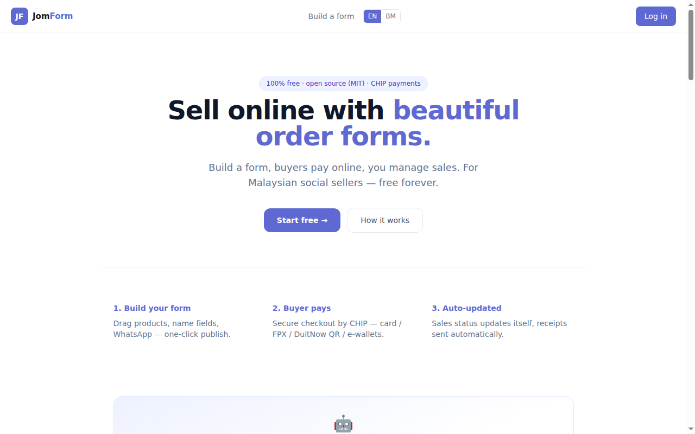

If you would rather not run a server, the hosted service is the same software.

---

## 1. What you need

| | |
|---|---|
| **Docker** | Docker Engine with the **Compose v2 plugin** — `docker compose version` must work. This is the `docker compose` subcommand, not the old `docker-compose` script |
| **openssl** | `openssl rand` generates this deployment's secrets |
| **A hostname** | e.g. `forms.example.com`, with an **A/AAAA record** pointing at the server. Passkeys and session cookies are bound to this host, so an IP address is not a substitute |
| **Ports** | 80 and 443 reachable from the internet — the front door obtains the TLS certificate through them |
| **RAM** | 2 GB minimum for the first build; 4 GB comfortable |
| **Disk** | 10 GB to start |

Measured on the clean install used for the screenshots: **six containers idle at
about 0.31 GB of RAM in total** (api 92 MB, web 68 MB, s3 66 MB, postgres 57 MB,
caddy 23 MB, valkey 5 MB), and **about 1.3 GB of images** (web 222 MB, api 151 MB,
object store 536 MB, postgres 304 MB, caddy 66 MB, valkey 45 MB). Those are the
idle numbers. The first start compiles the Go API and the Next.js app, and that
build — not the running stack — is the memory-hungry part of an install, so plan
for at least 2 GB.

You do not install Postgres, Valkey, Node or an object store: the stack ships all
of them, and only the front door is published.

## 2. DNS and TLS: Caddy, and only Caddy

**Caddy is the supported front door.** It is part of the stack, it is the only
service published to the host, and it does two jobs:

1. it terminates TLS — for an `https://` origin it obtains and renews the
   certificate itself from Let's Encrypt, with no certificate to paste and no
   cron job to install;
2. it performs the product's path split: public form pages, the REST/MCP
   surfaces, media and the OAuth discovery documents go to the API; everything
   else — including the dashboard's own `/api/` proxy — goes to the web app. The
   split lives in `deploy/selfhost/Caddyfile`.

Before you start, create the DNS record:

| Type | Name | Value |
|---|---|---|
| `A` | `forms` (or the host you chose) | your server's public IPv4 |
| `AAAA` | `forms` | your server's IPv6, if it has one |

Let's Encrypt validates over port 80, so the record must resolve **before** the
first start and stay in place — renewal uses it too.

Traefik is not part of this stack, and there is no second front-door
configuration to keep in step. If you already run a reverse proxy that owns
80/443, put it in front of this stack instead (point it at the published HTTP
port and reproduce the path split in `deploy/selfhost/Caddyfile`), and see § 10
for the port-conflict case.

## 3. Get the code and generate `.env`

```bash
git clone https://github.com/wzul/jomform.git
cd jomform
bash deploy/selfhost/bootstrap.sh --base-url https://forms.example.com
```

`deploy/.env` is generated by that command — do not write one by hand. The
bootstrap copies `deploy/.env.example` (the single source of the key set, so it
cannot drift from the compose file), mints the Postgres password, the S3 secret
and `ENCRYPTION_KEY` with `openssl rand -hex 32`, and derives the front-door
values from `--base-url`:

- `APP_BASE_URL` — the origin users load. It is also the **passkey relying
  party** and the base of every public form URL, so a wrong value here is a
  deployment whose passkeys and links never work.
- `APP_ENV` — `https://` becomes `prod`, `http://` becomes `dev`. This is not
  cosmetic: a `Secure` session cookie is never sent back over plain HTTP, so an
  `http://` install that claimed `prod` would appear to log in and then forget
  the session.
- `SITE_ADDRESS`, `HTTP_PORT`, `HTTPS_PORT` — the Caddy site and the published
  ports.

Two things it deliberately does **not** mint: a `SESSION_SECRET` (sessions are
opaque Valkey tokens; nothing reads such a variable) and a Valkey password
(Valkey is not published to the host, so there is nothing to authenticate).

Trying it on a laptop first is fine:

```bash
bash deploy/selfhost/bootstrap.sh --base-url http://localhost:8080
```

`http://` means no TLS and `APP_ENV=dev`. Passkeys only work over plain HTTP on
`localhost`, which is why the trial origin is `localhost` and not a LAN IP.

**A second run never rewrites a secret.** It validates the existing file, keeps
every generated value, and re-derives only what comes from `--base-url`. Keep
`deploy/.env`: it holds `ENCRYPTION_KEY`, which decrypts merchant payment
credentials stored in the database. Rotating it makes stored credentials
unreadable.

## 4. Start it and confirm every service

The bootstrap already did this; it is worth knowing how to read the result.

```bash
docker compose -f deploy/docker-compose.yml ps
```

```
NAME                        SERVICE    STATUS
jomform-api-1               api        Up (healthy)
jomform-caddy-1             caddy      Up (healthy)
jomform-postgres-1          postgres   Up (healthy)
jomform-s3-1                s3         Up (healthy)
jomform-valkey-1            valkey     Up (healthy)
jomform-web-1               web        Up (healthy)
```

Six services, six `(healthy)`. Then check the front door itself:

```bash
curl -s https://forms.example.com/healthz
# {"service":"jomform","status":"ok"}
```

| Service | Role |
|---|---|
| `caddy` | the only published service: TLS and the path split |
| `web` | dashboard and form builder (Next.js standalone) |
| `api` | REST, MCP, public form pages, media |
| `postgres` | data |
| `valkey` | sessions, rate limits, background queue |
| `s3` | uploaded media (an S3-compatible server) |

If a service is `starting` rather than `(healthy)`, wait — the first start runs
database migrations before the API reports ready. If it is `restarting`, go to
§ 10.

## 5. The first account

Signup is email-verified. Open your origin, then **Start free** (or go straight
to `/login`), choose **Login with password or register with a password**, and
take the **Sign up** tab.

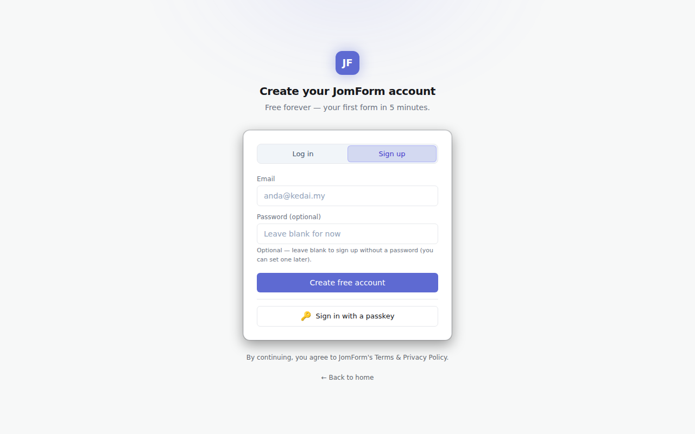

Password is optional at signup; a magic link is the other way in.

### If SES is not configured yet

A brand-new install has no email sender, so the confirmation mail cannot be
delivered. It is not lost: the API writes the verification link to its own log.

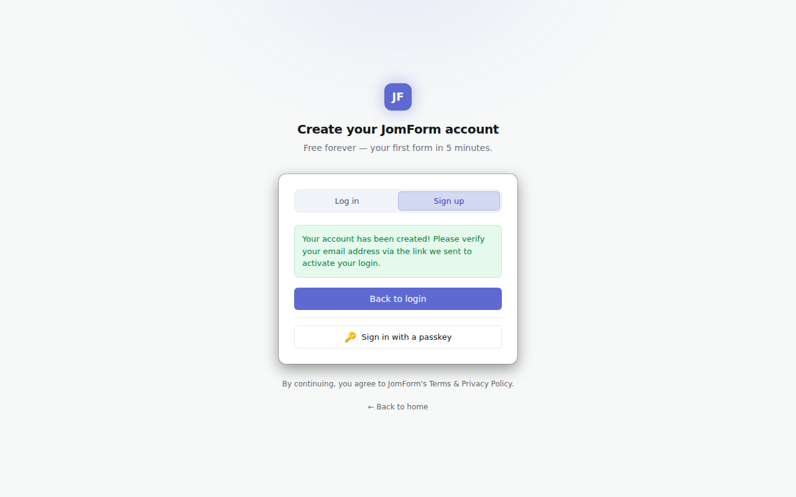

```bash
docker compose -f deploy/docker-compose.yml logs api \
  | grep -o 'http[^ ]*/v1/auth/verify?token=[^ "]*'
```

Open that link (valid 24 hours):

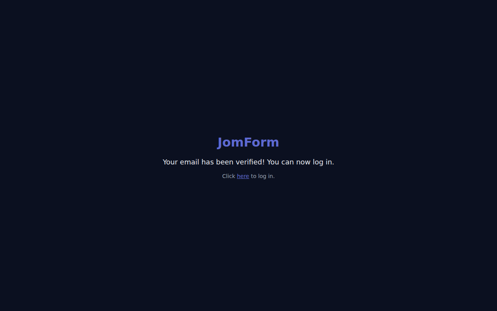

This log fallback is controlled by `JOMFORM_LOG_VERIFY_LINK=1` in `deploy/.env`
(the shipped default). It is ignored as soon as SES can actually send. Configure
SES (§ 8) and set it to `0` — until you do, password reset and magic-link login
have nothing to send either.

### Sign in, then create the workspace

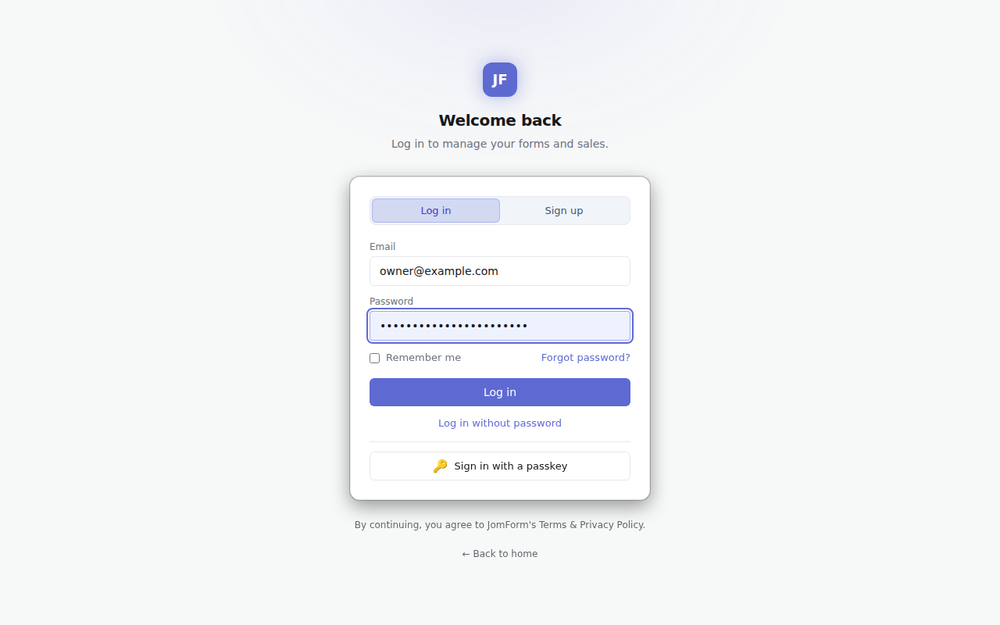

A new account has no workspace yet, so you land on the workspace picker. Pick a
name and a URL slug (lowercase, digits, dashes):

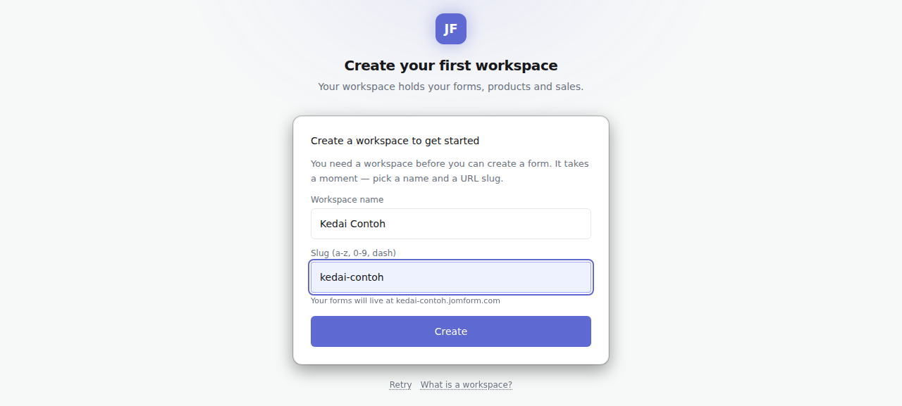

That lands on the dashboard:

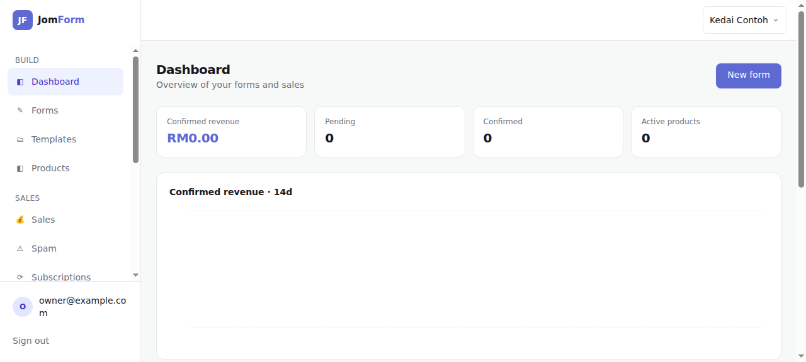

## 6. Create and publish your first form

**Forms → New form** opens the template picker. Either take a template or start
from **Blank form**:

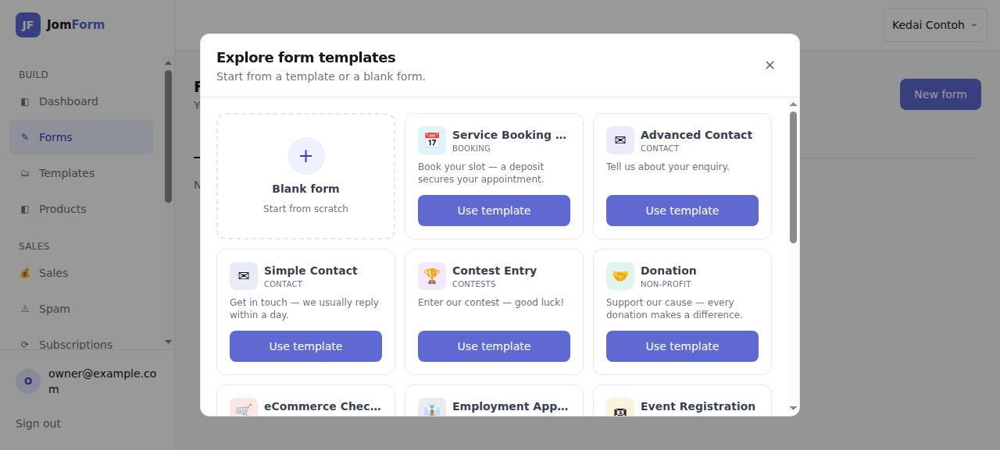

In the builder: set the **Form title**, then add blocks by clicking them in the
left palette (or drag them onto the canvas). The screenshot below has a Name and
an Email block, and the form mode is **Response form** — no products, no payment:

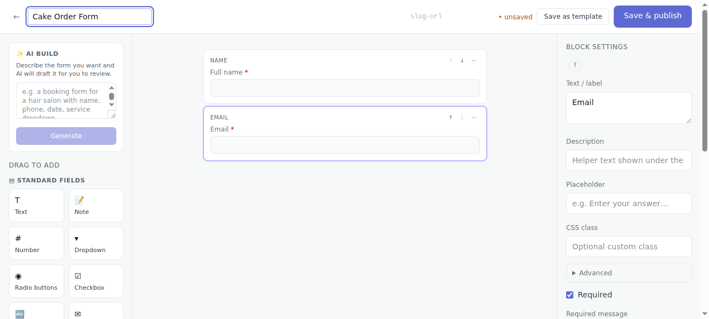

**Save & publish** makes it live:

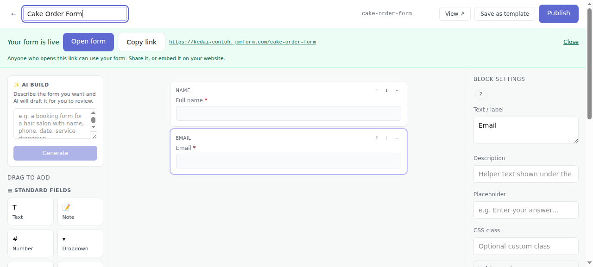

> **The link is your install's own origin.** The dialog's **Copy link** button
> prints (and the "Open form" target is) your own public address — a
> self-hosted install has ONE origin, the `APP_BASE_URL` you set, and no
> per-workspace subdomains:
>
> | What | Address on your install | Address on the hosted product |
> | --- | --- | --- |
> | Workspace (dashboard-facing address) | `https://forms.example.com/` | `https://<workspace>.<product-domain>` |
> | A published form | `https://forms.example.com/f/<form-slug>` | `https://<workspace>.<product-domain>/<form-slug>` |
> | Custom domain (`Settings → Domains`) | CNAME it to **your install's host**, e.g. `forms.example.com` | CNAME it to the product's own CNAME target, which `Settings → Domains` prints beside the record |
>
> i.e. `{APP_BASE_URL}/f/{slug}` — the same stack serves it through Caddy, so
> nothing extra has to be configured for the `/f/<slug>` route. One hostname
> serves every workspace, and a form whose slug two workspaces both hold answers
> 404 rather than guessing.
>
> The dashboard, the REST payloads and the MCP tools all read the deployment
> from `GET /v1/meta` (`{"origin": ..., "self_hosted": true}`) and name your own
> origin — the slug identifies the workspace, it is not part of the address.
>
> (The product domain is left as `<product-domain>` here on purpose: this page is
> read by install scripts and operators who run their own domain, and a literal
> hostname in it would be copied onto an install that does not serve it.)

For a payment form, do § 7 first and add at least one product; a payment form
with nothing sellable has no checkout to show.

A buyer opening the public address gets a standalone page — no dashboard, no
login:

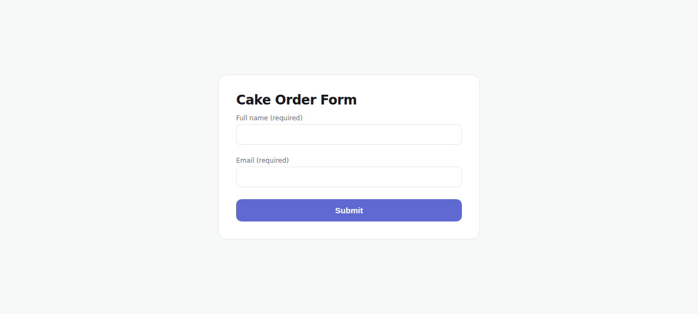

Submitting it works end to end:

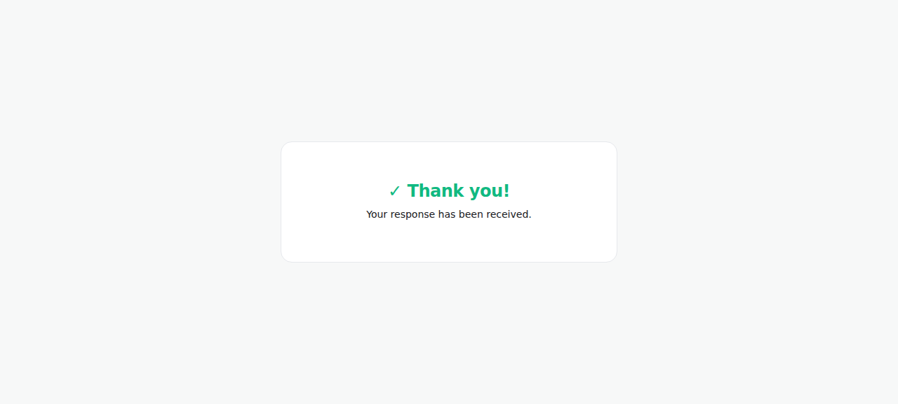

## 7. Connect CHIP (sandbox)

Payments go through [CHIP](https://chip-in.asia) Collect, and the credentials are
**per workspace**, entered in the dashboard — they are not part of `deploy/.env`.

**Settings → CHIP**, then paste the Brand ID and the Secret Key from the CHIP
Merchant Portal (Developers):

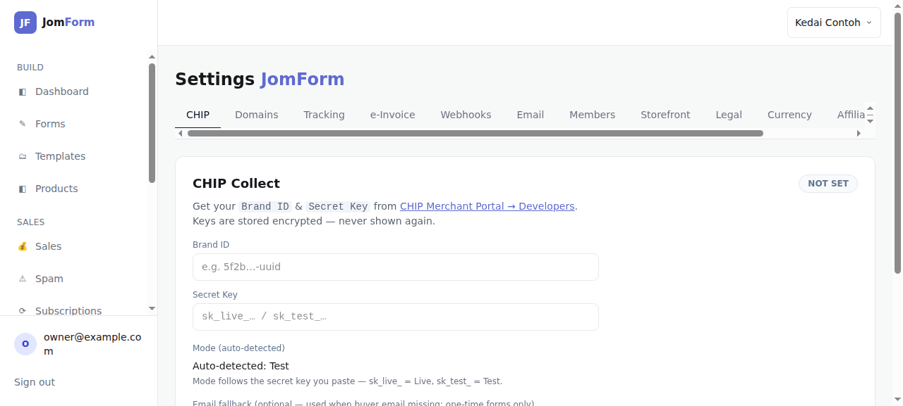

- **Mode is detected from the key, not chosen.** `sk_test_…` is Test,
  `sk_live_…` is Live. Start with the sandbox/test key; nothing else in this step
  needs a live merchant account.
- Keys are stored **encrypted** with `ENCRYPTION_KEY` and are never shown again
  after saving — this is the value a database backup cannot restore without
  `deploy/.env` (§ 9).
- **Save** verifies the key against CHIP's API. A key that is rejected is not
  reported as connected; check the message under the field, not just the tab.
- Payment methods can be restricted per workspace; blank means all available.

## 8. Transactional email (SES) — optional

Without a sender, JomForm still works: signup verification falls back to the API
log (§ 5), and email features report themselves unavailable instead of
half-working. Buyers do not get receipts.

The sender is the **AWS SESv2 API**, not a plain SMTP relay, but the credentials
are the SES SMTP credentials from the SES console (the SMTP username is the
access key id; the API uses the pair as static AWS credentials). Set them in
`deploy/.env` and restart:

```bash
# deploy/.env
SES_SMTP_HOST=email-smtp.ap-southeast-1.amazonaws.com
SES_SMTP_USER=<SES SMTP username>
SES_SMTP_PASS=<SES SMTP password>
SES_FROM=forms@example.com          # a verified identity in that SES account
SES_REGION=ap-southeast-1
JOMFORM_LOG_VERIFY_LINK=0           # links go by email now, not to the log
```

```bash
bash deploy/selfhost/bootstrap.sh    # reads the saved APP_BASE_URL, restarts
```

The dashboard's **Settings → Email** tab does **not** configure SES — it
customises the receipt that is sent through it:

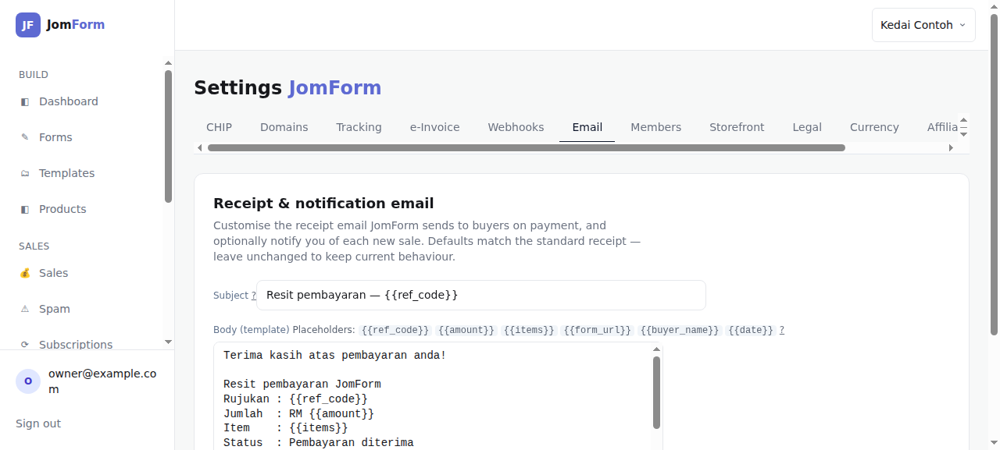

A new SES account is in the sandbox until you request production access, so mail
only reaches verified addresses at first.

## 9. Backups and upgrades

Back up **two things together**; one without the other is not a restore.

```bash
# 1. the database
docker compose -f deploy/docker-compose.yml exec -T postgres \
  pg_dump -U jomform jomform | gzip > jomform-$(date +%F).sql.gz

# 2. the env file — it holds ENCRYPTION_KEY, which decrypts merchant credentials
cp deploy/.env ./jomform-$(date +%F).env
```

Uploaded media lives in the stack's `s3data` volume. Volume snapshots alongside
the dump are enough; if you prefer a tarball:

```bash
docker run --rm -v jomform_s3data:/data -v "$PWD":/out alpine \
  tar czf /out/media-$(date +%F).tar.gz -C /data .
```

Test a restore once, before you need one: a dump restored without `deploy/.env`
comes back with credentials nobody can read.

**Upgrade in place** — pull, then re-run the bootstrap. It validates the existing
`.env` (never rewriting a secret) and rebuilds what changed:

```bash
git pull
bash deploy/selfhost/bootstrap.sh
docker compose -f deploy/docker-compose.yml ps   # all six healthy again
```

Pin a version by checking out a tag or commit before the pull if you do not want
to track `main`.

## 10. Troubleshooting

**`bootstrap: REFUSED — placeholder secret(s) in …/deploy/.env`**
The env file already existed, so it was not generated over. Replace each named
key with `openssl rand -hex 32`, or delete `deploy/.env` and re-run the bootstrap
to have them generated. Never keep a key that appears in this repository.

**A container restarts in a loop (`docker compose ps` shows `restarting`).**
Almost always a placeholder secret from `deploy/.env.example` reaching the API.
`ENCRYPTION_KEY` must be 64 hex characters; the API exits with
`ENCRYPTION_KEY must be 64 hex chars (32 bytes)` and, because the service is
`restart: unless-stopped`, restarts forever instead of failing once. Read the
reason:

```bash
docker compose -f deploy/docker-compose.yml logs api | tail -20
```

Fix the value (or delete `deploy/.env` and re-run the bootstrap), then
`docker compose -f deploy/docker-compose.yml up -d`.

**`docker compose config` says `… is required — run deploy/selfhost/bootstrap.sh`.**
A secret the compose file needs is unset. Run the bootstrap rather than
`docker compose up` by hand; every secret in this stack is required on purpose,
so a stack cannot come up on a key that is published in the repository.

**502 Bad Gateway — the page does not load.**
Caddy is up but the web app is not answering. Check, in this order:

```bash
docker compose -f deploy/docker-compose.yml ps            # is web (healthy)?
docker compose -f deploy/docker-compose.yml logs --tail=50 web
docker compose -f deploy/docker-compose.yml logs --tail=50 caddy
```

`web` does not come up until `api` is healthy, and the API runs the database
migrations before it reports ready — so a 502 in the first minute or two of a
start is normal. A 502 that persists means `web` is restarting or exited; read its
log, not Caddy's.

**The public form 404s.**
Public forms are served by *this* stack at `{APP_BASE_URL}/f/{slug}`. Three
common causes, in order: (a) you opened the hosted-shaped link the builder's
Copy link printed (`<workspace>.<product-domain>/<slug>`) — that host does not
exist on your install, use `/f/`; (b) `APP_BASE_URL` names a different host from
the one in your address bar, so the origin the API builds links for is not the
origin you are loading; (c) the form is still a draft — publishing is what makes
`/f/<slug>` resolve. Re-run the bootstrap with the real `--base-url` for (b).

**Passkeys refuse to register or sign in.**
The passkey RP ID is the **host of `APP_BASE_URL`**, and a browser refuses an RP
ID that is not the page's own origin (or a parent domain of it). So the value
must be the host in the address bar: `https://forms.example.com` for
`forms.example.com`, and plain-`http` passkeys work only on `localhost`. A
mismatch is a deployment whose passkeys can never work; fix `APP_BASE_URL` and
re-run the bootstrap. Passkeys also fail on an origin served through an IP
address, or over HTTP on anything but `localhost`.

**`Bind for 0.0.0.0:443 failed: port is already allocated`.**
Another web server owns the port. Set `HTTP_PORT` / `HTTPS_PORT` in `deploy/.env`
before the first start (the bootstrap keeps numeric values it finds there and
only overrides them when `--base-url` names a port itself), or put your own proxy
in front and let it own 80/443 — see § 2.

**Login succeeds and then I am logged out.**
The origin in `APP_BASE_URL` is not the origin you are loading, or you are on
plain HTTP with `APP_ENV=prod`. Re-run the bootstrap with the real `--base-url`.

---

## Ringkasan BM

Panduan penuh di atas dalam Bahasa Inggeris; ini urutannya:

1. **Prasyarat** — Docker + Compose v2, `openssl`, hostname dengan rekod A/AAAA,
   port 80/443 terbuka. RAM 2 GB (diukur: ~0.31 GB semasa idle), disk 10 GB.
2. **DNS + TLS** — Caddy ialah front door yang disokong: ia ambil sijil TLS
   sendiri dan membahagi laluan web/api.
3. **Kod + `.env`** — `bash deploy/selfhost/bootstrap.sh --base-url https://forms.example.com`.
   Skrip ini jana semua rahsia; jangan tulis `.env` sendiri, jangan tukar
   `ENCRYPTION_KEY` selepas mula.
4. **Mula** — enam servis mesti `(healthy)`; semak `…/healthz`.
5. **Akaun pertama** — daftar di `/login`, sahkan emel. Tanpa SES, pautan
   pengesahan ada dalam `docker compose logs api`. Kemudian cipta workspace.
6. **Borang pertama** — Forms → New form → isi tajuk → tambah blok → Save &
   publish. Pautan awam sebenar: `{APP_BASE_URL}/f/<slug>` (butang Copy link
   masih cetak pautan produk hosted — batasan yang diketahui).
7. **CHIP sandbox** — Settings → CHIP, tampal Brand ID + Secret Key `sk_test_…`;
   mod dikesan automatik daripada kunci.
8. **Emel (SES, pilihan)** — `SES_SMTP_*`, `SES_FROM` dalam `deploy/.env`,
   kemudian jalankan bootstrap semula dan set `JOMFORM_LOG_VERIFY_LINK=0`.
9. **Sandaran + naik taraf** — `pg_dump` **dan** `deploy/.env` bersama; naik
   taraf dengan `git pull && bash deploy/selfhost/bootstrap.sh`.
10. **Masalah lazim** — 502 (web belum sihat), borang awam 404 (guna `/f/<slug>`,
    bukan pautan hosted), passkey gagal (RP ID mesti host `APP_BASE_URL`),
    container berulang restart (rahsia placeholder dalam `.env`).

## Licence

MIT. See `LICENSE`. The hosted service is a separate offering; the licence
covers this code, not that instance.
