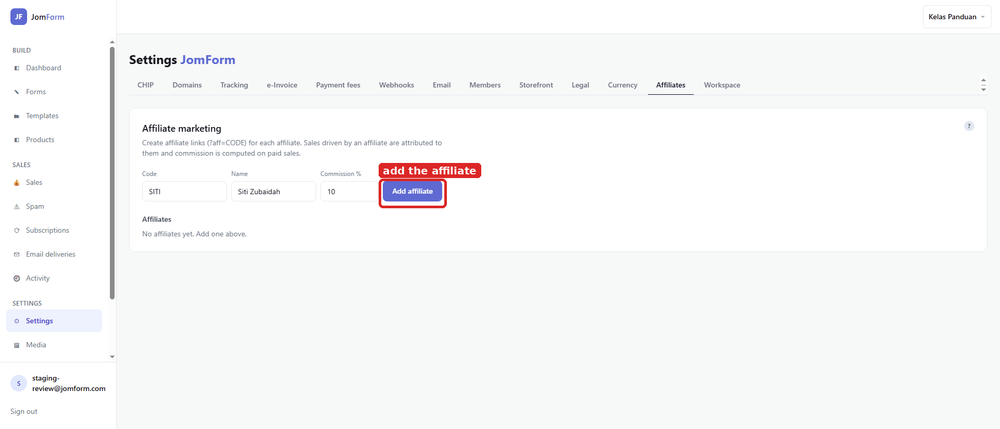
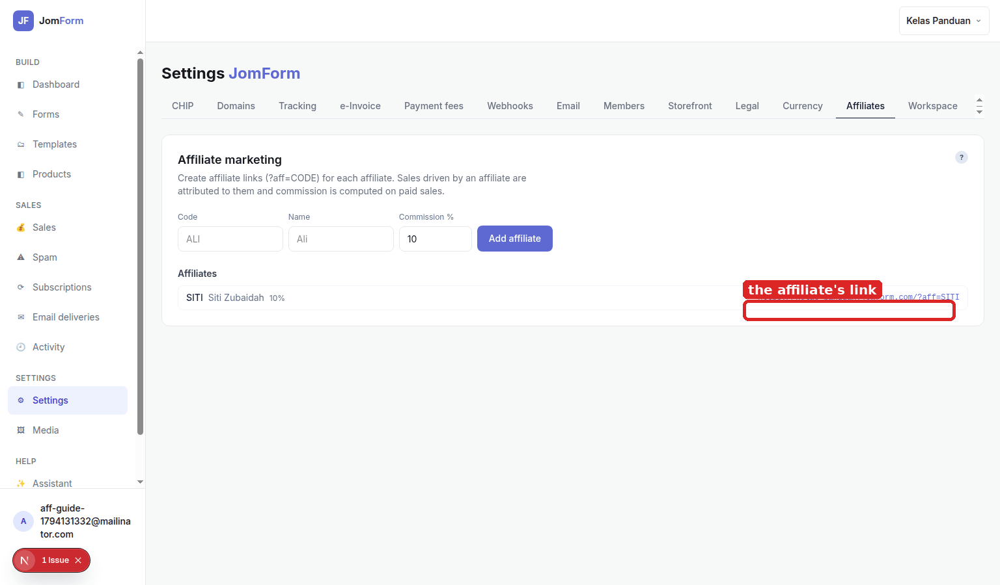

# Affiliate programme: setup guide

Give someone a link, and the sales that arrive through it are attributed to them with a commission
on every paid sale. Every screenshot here was captured from the running product; the red box marks
the control you touch at that step.

**What this does:** an affiliate is a code in a workspace. A sale that arrives with that code attached
is attributed to the affiliate. The commission you set here is computed on the **paid** sale, not on
the form view and not on an abandoned checkout.

## 1. Create the affiliate

Settings → **Affiliates**. Fill **Code** (the short code that goes in the link, `SITI` here),
**Name** (who it belongs to), **Commission %** (10 here) and press **Add affiliate**. The code is
unique inside the workspace; a second `SITI` is refused with *code already exists*.

## 2. Hand over the link

The new row carries the affiliate's own link:
`https://<workspace>.jomform.com/?aff=SITI`. Anything a visitor buys after opening that URL is
attributed to SITI, and 10% of the paid amount is her commission. The code is per workspace, so the
same person promoting two workspaces has two links.

## How the commission is counted

- **Only paid sales count.** A commission exists because a payment settled. An unpaid checkout, a
  refused card or a form response with no product contributes nothing.
- **The sale records the code, not the money.** Each sale carries the affiliate code that brought it
  in, and the commission is the affiliate's rate applied to that sale. The row above is the one
  place the percentage lives.
- **Cancelling a card never revokes anything on the affiliate side.** Attribution follows the sale
  record, not the card token.

## Notes

- **One code per promotion, not per person.** A merchant tracking two channels (a WhatsApp group and
  an Instagram bio) uses two codes, and each channel gets its own commission line.
- **Driving this from an agent:** the same three operations exist as MCP tools
  (`create_affiliate`, `list_affiliates`, `set_affiliate_commission`), and they return the same
  `referral_url` the tab shows.
