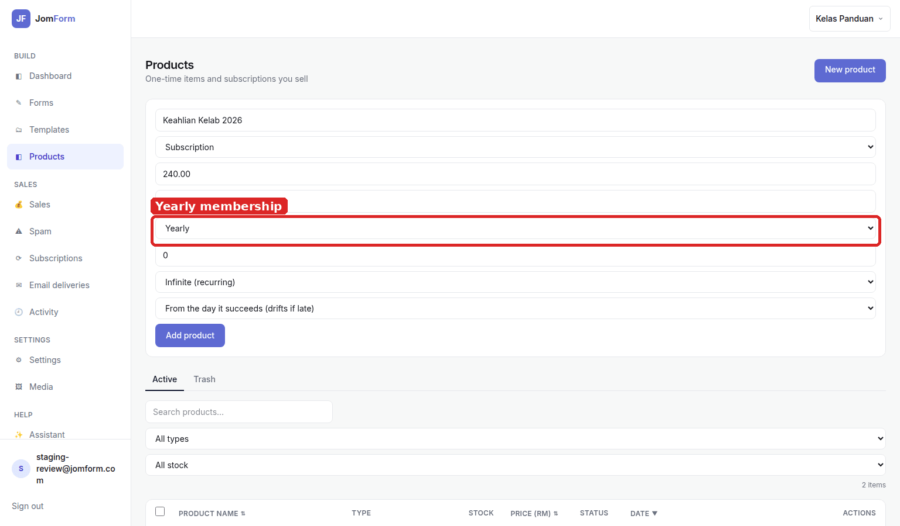
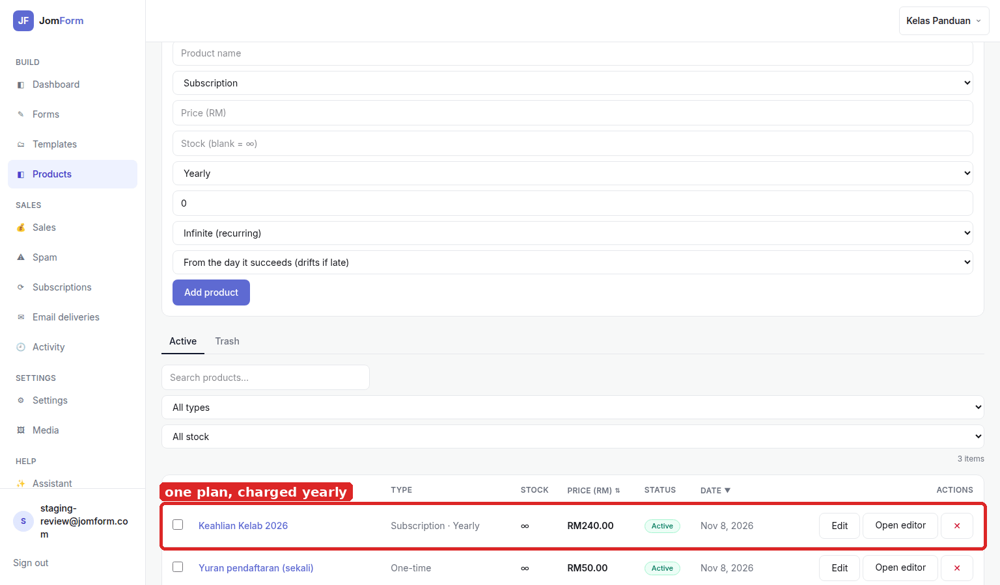
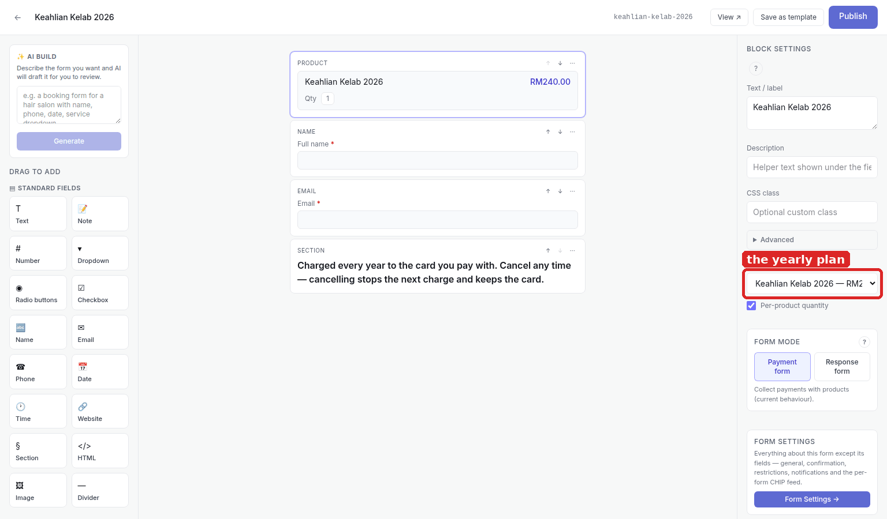
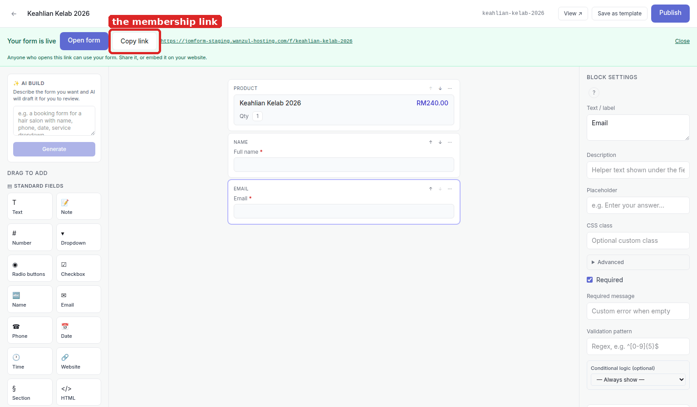
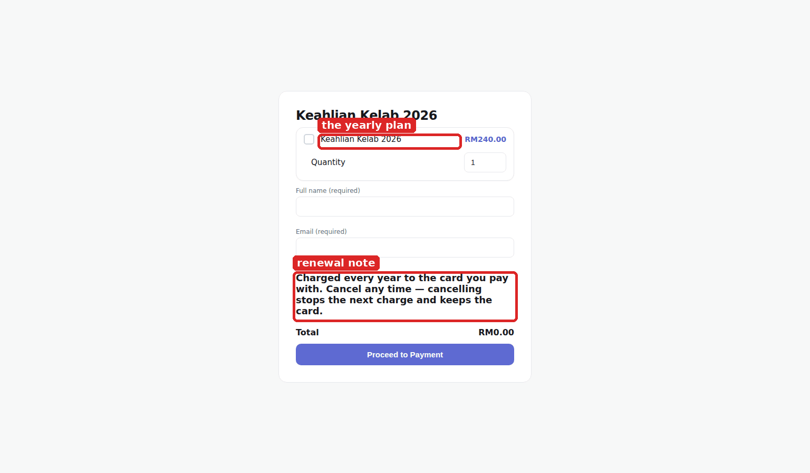

# Club membership — setup guide

One membership, one fee that repeats, and nobody has to remember to pay next year. Every screenshot
here was captured from the running product; the red box marks the control you touch at that step.

**What this does:** a membership is a single **Subscription** product — monthly or yearly — sold from
any payment form. The member pays once with a card at checkout; the card is saved, and the same card
is charged every period after that. There is no spreadsheet of who has paid and no bank transfer to
reconcile.

## 1. Create the plan as a Subscription product

Products → **Product name** (here *Keahlian Kelab 2026*), **Price (RM)** 240.00, then change **Type**
to **Subscription** and set **Billing period** to **Yearly** (or *Monthly* for a monthly club).
**Billing count** *Infinite (recurring)* means it renews until cancelled; **Next charge date**
*From the day it succeeds* starts the cycle on the first successful payment.

## 2. Check the plan in the catalogue

The row reads **Subscription · Yearly · RM240.00**. That one row is the whole plan — every member of
the club is sold this same product, so a price change is a single edit here.

## 3. Sell it from a payment form

Forms → **New form** → **Blank form**, then add **Product** under *PRICING FIELDS*, **Name** and
**Email**. Select the Product block and pick the plan in **BLOCK SETTINGS → Product**. A **Section**
block under the email is worth the thirty seconds it costs: it renders as prose (a *Note* block would
render an input the member has to fill), so it can tell the member the fee renews.

## 4. Publish and hand out the link

**Publish** makes the form live and the banner gives you the address
(`…/f/keahlian-kelab-2026`). **Copy link** is what goes to the members — one link for the whole club,
no per-member form.

## 5. What the member does

The member ticks the plan, sees **RM240.00**, fills **Full name** and **Email**, reads the renewal
note and presses **Proceed to Payment** once. That is the last time they type a card number: the card
is saved at that payment and charged every year after it.

## Notes

- **Cancelling stops the next charge, not the card.** Cancelling a membership ends future charges and
  leaves the saved card alone — a member who rejoins does not re-enter it.
- **Members and recurring plans live under Subscriptions** in the sidebar, where a due charge can be
  retried or a plan cancelled. The same actions exist over MCP if you drive JomForm from an agent.
- **Yearly vs monthly is a product setting, not a form setting.** The same form can sell a monthly
  plan and a yearly plan as two products — put both Product blocks on the form and let the member
  pick.
