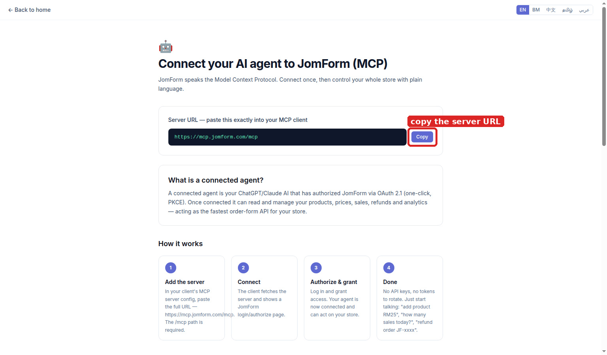
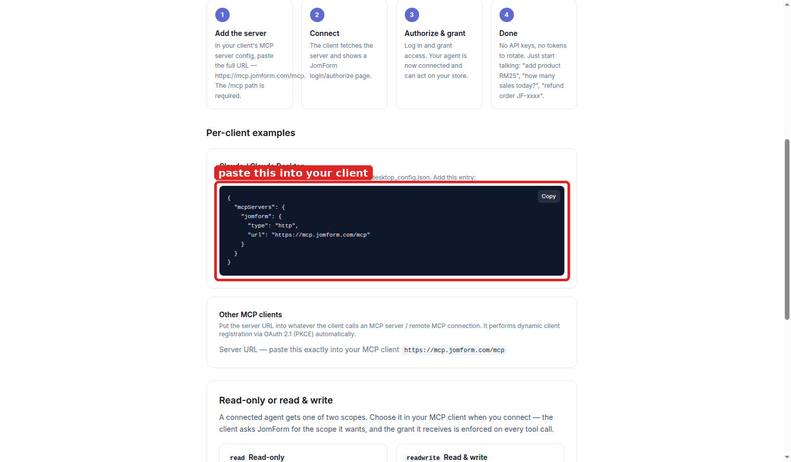
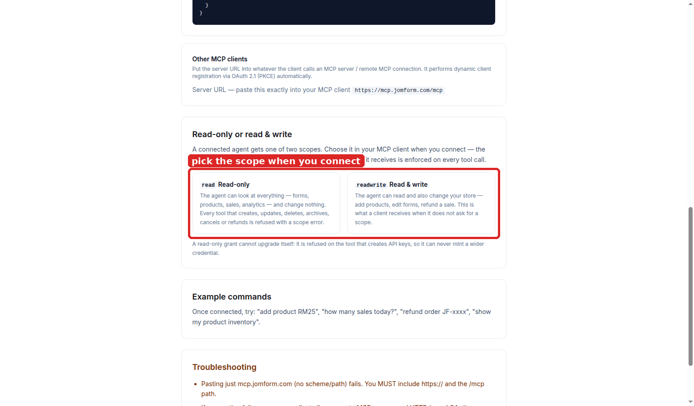
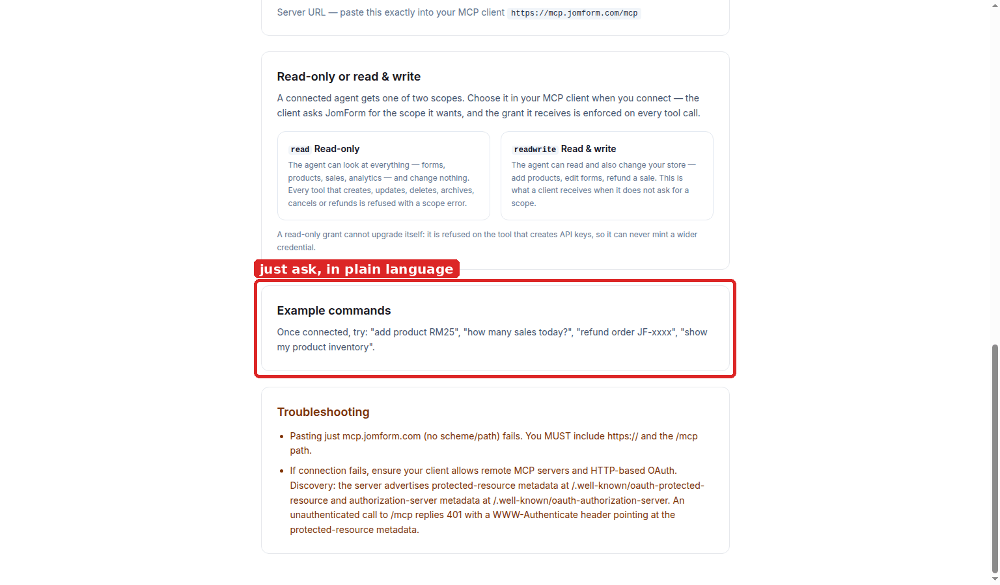

# Design with an AI agent (MCP): setup guide

JomForm speaks the Model Context Protocol. Connect your AI agent once and it can drive the store with
plain language: add products, edit forms, read sales, refund a sale. Every screenshot here was
captured from the running product; the red box marks the control you touch at that step.

## 1. Open the connect page and copy the server URL

The **MCP** page (`/mcp` on your JomForm address) is the whole setup, and it prints the one thing you
need: **`https://mcp.jomform.com/mcp`**. The `/mcp` path is required: `mcp.jomform.com` without it
fails. Press **Copy**.

## 2. Paste it into your MCP client

Claude Desktop reads its servers from `claude_desktop_config.json`; the page prints the exact entry
(`{"mcpServers": {"jomform": {"type": "http", "url": "https://mcp.jomform.com/mcp"}}}`). Any other
client that supports a remote MCP server over HTTP takes the same URL instead. Restart the client
after saving.

## 3. Authorise

The client fetches the server, finds the OAuth 2.1 (PKCE) endpoints itself and opens a JomForm login
or authorise page. Sign in and grant access. **There is no API key to copy and no token to rotate**:
the grant is the credential.

## 4. Pick the scope

The client asks for a scope and the grant is enforced on every tool call:

| scope | what the agent can do |
|---|---|
| **read** | look at forms, products, sales and analytics. Every tool that creates, updates, deletes, archives, cancels or refunds is refused with a scope error |
| **readwrite** | do all of that **and** change the store: add a product, edit a form, refund a sale |

A client that asks for no scope gets **readwrite**. A read-only grant cannot upgrade itself: it is
refused on the tool that mints API keys, so it can never manufacture a wider credential.

## 5. Ask for what you want

That is the whole interface from here on. *"add product RM25.00"*, *"how many sales today?"*,
*"refund sale JF-xxxx"*, *"show my product inventory"*: the agent calls the matching tool and
answers. The same plain language works for forms, prices and analytics, and a tool that would change
something is a call the scope above has to allow.

## Notes

- **Discovery is automatic.** The server advertises protected-resource metadata at
  `/.well-known/oauth-protected-resource` and authorization-server metadata at
  `/.well-known/oauth-authorization-server`. An unauthenticated call to `/mcp` answers `401` with a
  `WWW-Authenticate` header pointing at the metadata.
- **Connecting from Canva (or any agent that is not a coding client):** it needs to allow a remote
  MCP server with HTTP OAuth. Where the client has no JSON config, paste the server URL into the
  field it calls *remote MCP server* / *MCP connection*.
- **The agent acts inside one workspace.** Tools take a workspace, so the same connection can drive
  every workspace your account can manage, and nothing outside them.
