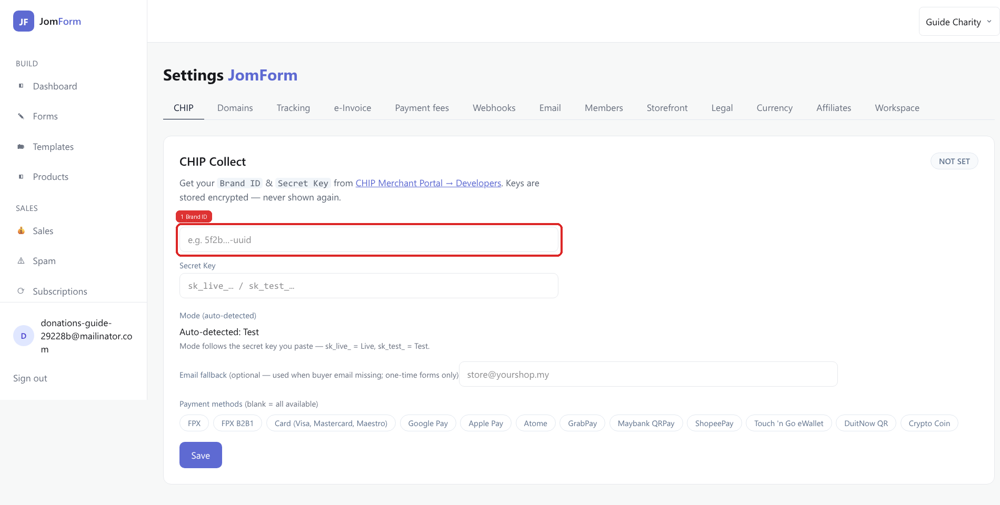
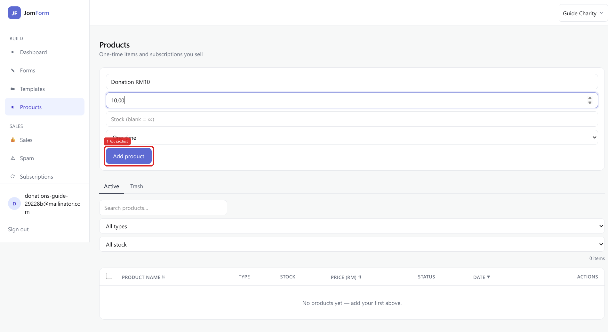
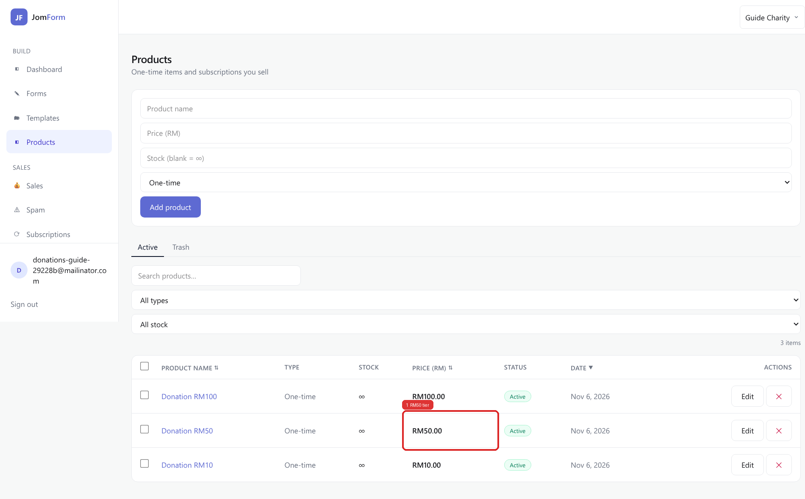
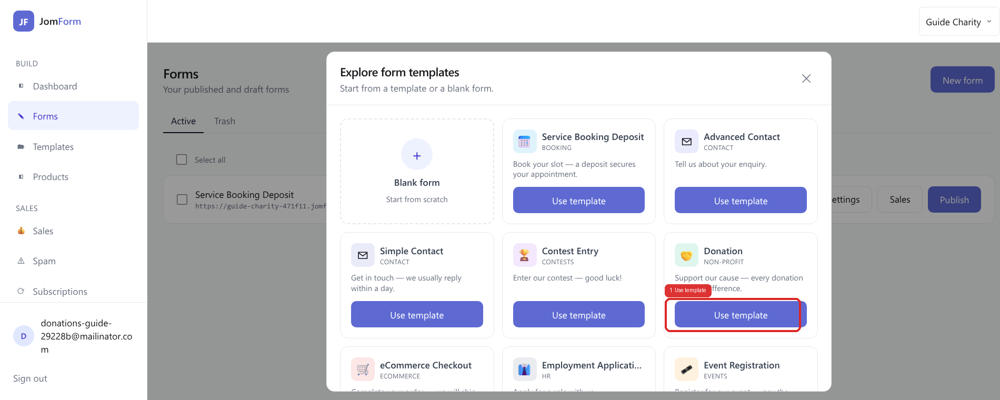
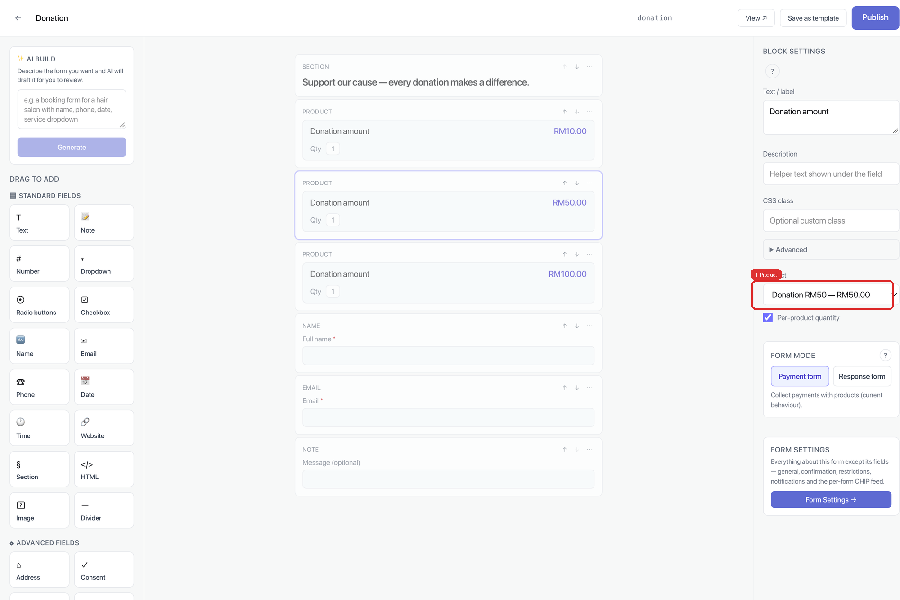
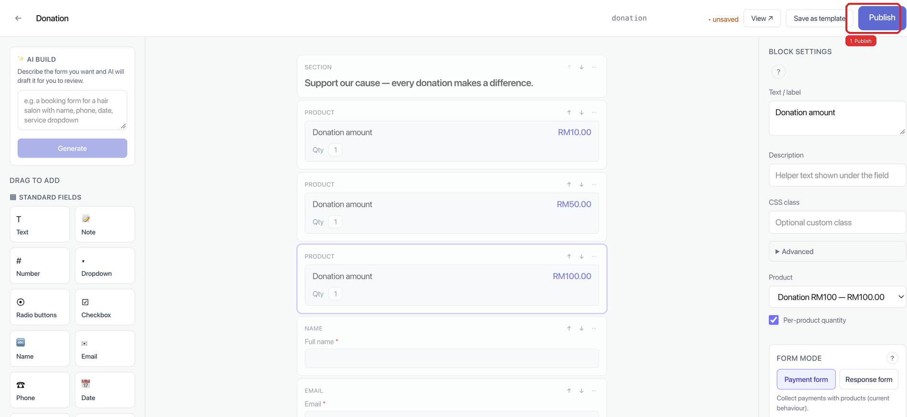
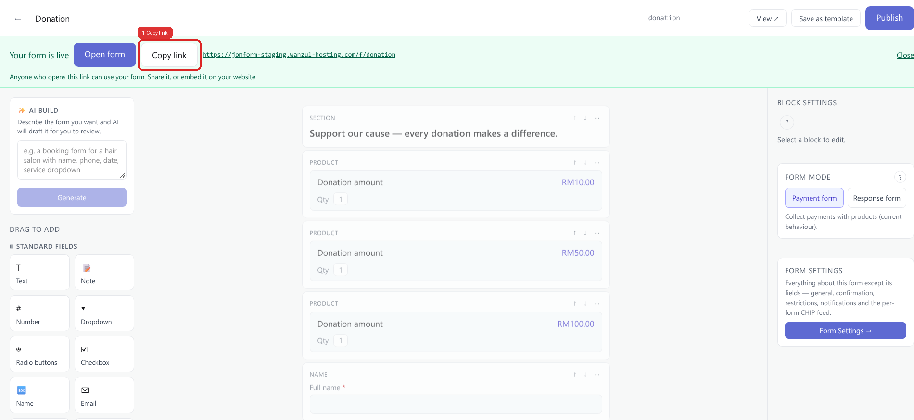
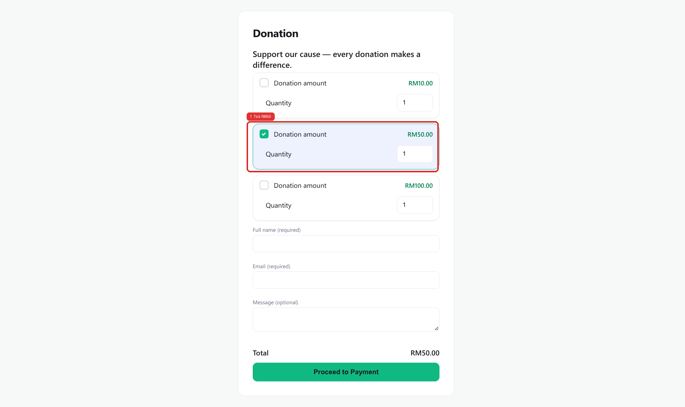

# Collect donations — setup guide

A step-by-step guide to taking donations with a JomForm payment form. Every screenshot below was
captured from the running product; the red box marks the one control you touch at that step.

**What this does:** a donation is a normal payment form, and an amount is a **product**. There are
two shapes of donation product:

- **Fixed denominations** — one product per amount you accept (`Donation RM10`, `Donation RM50`,
  `Donation RM100`), and the donor ticks the one they want. Steps 2–8 below walk this shape.
- **Pay what you want** — a single product set to *Pay what you want (donation)*: the form shows the
  donor an amount field instead of a price, and the amount is checked against the limits you set.
  See the first two Notes.

Either way the money lands in the same sale list and receipt flow as any other paid form.

## 1. Connect CHIP Collect in Settings

Settings → **CHIP**. Paste the **Brand ID** and **Secret Key** from the CHIP Merchant Portal and save;
the mode is auto-detected from the key (`sk_test_…` = Test, `sk_live_…` = Live), and this is what
turns the form's pay button into a working payment.

## 2. Add your first donation amount in Products

Products → type the name (**Donation RM10**), the price (**10.00**), leave **Type** on *One-time*,
then **Add product** — the price you type is exactly what the donor pays for that tier.

## 3. Add the other amounts

Repeat step 2 for **Donation RM50** and **Donation RM100**; each tier is its own product, and the
price cell is the amount a donor gives when they pick that tier.

## 4. Start from the Donation template

Forms → **New form** opens the template gallery → **Use template** on *Donation*, which gives you a
payment form already carrying a product block, name, email and an optional message.

## 5. Point each Product block at one amount

Add one **Product** block per amount — the quickest is the block's **⋯ → Duplicate** menu on the
block the template gave you (*Pricing Fields → Product* in the palette also inserts one) — then
select a block and choose its tier in the **Product** dropdown; the buyer sees that product's name
and price on the form (a pay-what-you-want product shows the amount field instead — see Notes).

## 6. Publish

**Publish** writes the form and puts it live; until you click it the toolbar shows the unsaved state
and the form stays a draft that no one else can open.

## 7. Copy the donation link

The green *Your form is live* banner confirms the publish and holds the donor URL — **Copy link** (or
**Open form**) is what you paste into WhatsApp, a poster QR code, or your website.

## 8. What the donor sees

The donor ticks one amount (RM50 here), the total updates to **RM50.00**, and *Quantity* lets them
give a multiple of a tier; after filling name and email they proceed to payment.

## Notes

- **A product's price can be fixed or chosen by the donor.** A product's type is `one_time`,
  `subscription` or `custom_amount`. The tiers in steps 2–3 are `one_time` products — one price
  each. A `custom_amount` product (*Pay what you want (donation)*) has no fixed asking price: the
  form renders an amount field instead of a price, and the **server** checks the amount the donor
  typed against that product's **Minimum amount** (never below RM1.00), its optional **Maximum
  amount** and its optional **Suggested amount** before it prices the sale. An amount outside those
  limits is refused with a readable reason and nothing is charged; an accepted one becomes the
  line item's price, and the sale appears under **Sales** with that amount. The price stored on
  such a product is for display only — the suggested amount when one is set, else the minimum.
- **Where each shape lives.** The Products page add row in step 2 creates *One-time* products —
  that is the fixed-denomination walkthrough in steps 2–8. The pay-what-you-want type is chosen on
  the product editor page (`/products/new`, or `/products/<id>/edit`).
- **A new amount later.** For a fixed tier: step 2 plus one more **Product** block in the builder,
  then Publish again. For a pay-what-you-want product: a change to that product's minimum, maximum
  or suggested amount.
- **Nothing can be charged until step 1 is done.** On a workspace with no CHIP credentials the pay
  button answers *"We could not start the payment, so nothing was charged"* with an order reference,
  and that order shows up under **Sales** as `failed` — the donation is never silently collected as a
  free response.
- **Each donation is an order from the first click.** The order appears under **Sales** with its
  reference (`JF-…`), the donor's name and email, what they picked and the amount; once CHIP
  confirms the payment the order moves to `paid` and the donor is emailed the workspace's receipt.
