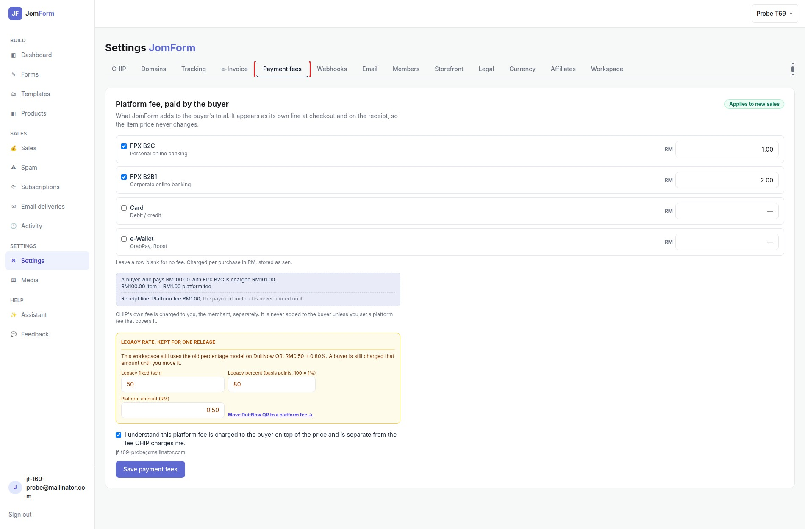
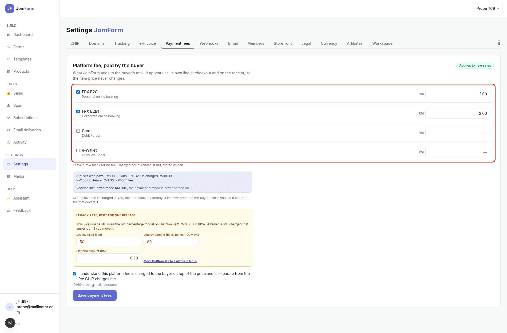
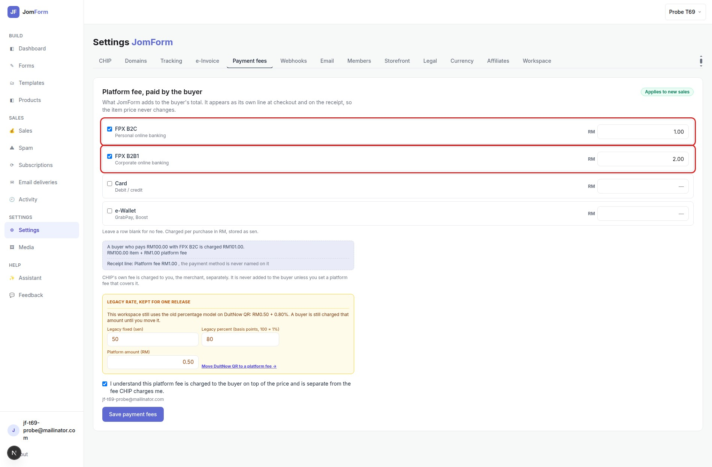
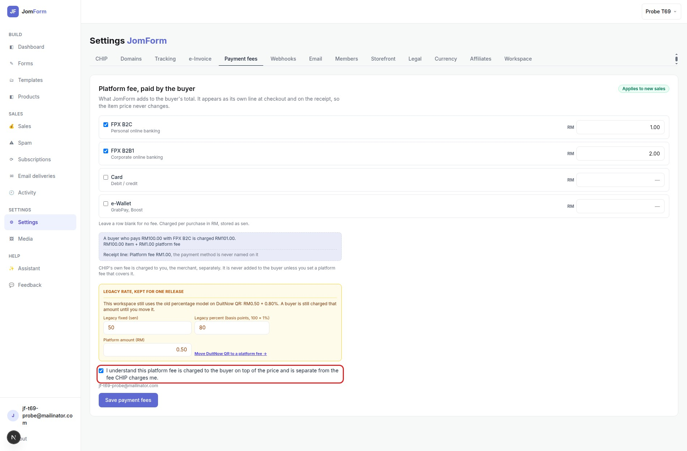
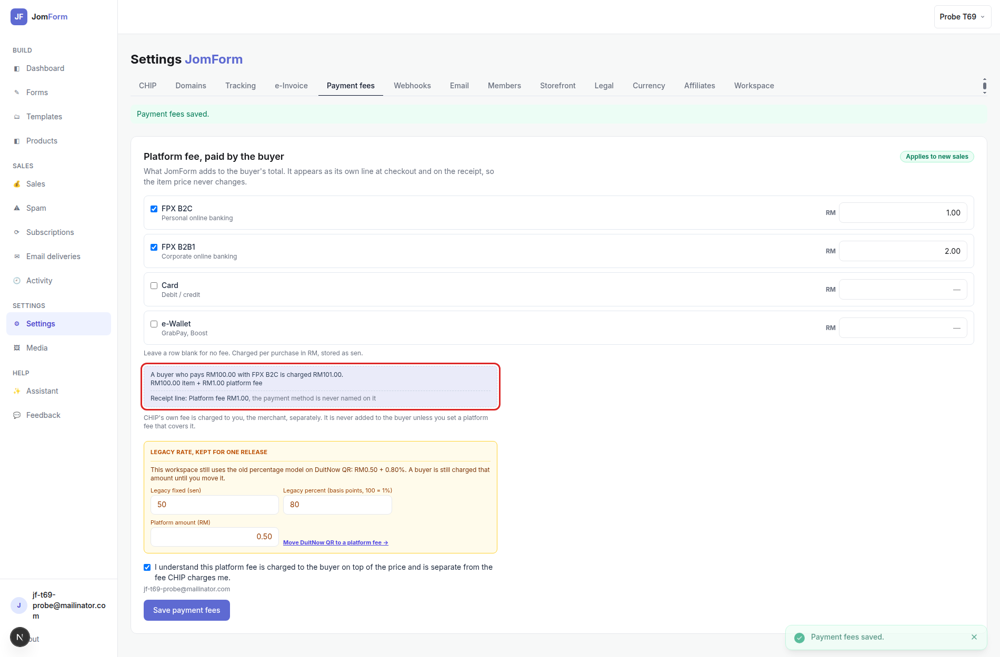
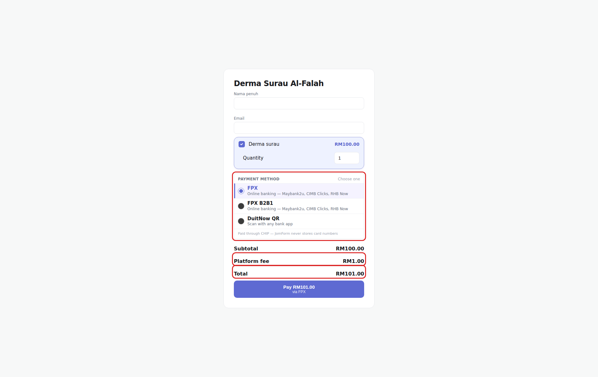

# Payment fees: merchant setup guide

Set one flat platform fee per payment method; JomForm adds it to the buyer's price as its own line, so the amount they typed never changes.

**What this does:** the platform fee is JomForm's own charge, added on top of the price at
checkout. It is separate from what CHIP charges you, the merchant.

## 1. Open Settings → Payment fees

Settings → **Payment fees**, the tab between *e-Invoice* and *Webhooks*. Only workspace admins and
owners see it.

## 2. Set a platform fee per method

One row per method, each with its own amount in **RM**. Type `1.00` for a RM1.00 fee on every
purchase of that method. **Leave a row blank for no fee**, and untick a method to stop charging
it.

## 3. Split FPX B2C and FPX B2B1

FPX is two CHIP identifiers, and each takes its own amount: **FPX B2C** for personal online
banking, **FPX B2B1** for corporate. They are two buyer choices too, so the picker always shows
both rows (when both are enabled) and each carries the amount set for its own product.

## 4. Acknowledge the disclosure

Enabling a fee requires this tick. It records that the platform fee is charged to the buyer on top
of the price and is separate from what CHIP charges you, together with who accepted it and when.

## 5. Save

Saving is immediate: the green **Payment fees saved.** banner confirms it. The example box shows a
RM100.00 order and the receipt line side by side — **Platform fee RM1.00**, with no payment-method
name on it.

## 6. What your buyer sees

The buyer picks the method above the Pay button, and the fee line, the total and the button follow
that choice. With RM1.00 for FPX B2C and RM100.00 on the form:

| Line | Amount |
|---|---|
| Subtotal | RM100.00 |
| Platform fee | RM1.00 |
| **Total** | **RM101.00** |

The item line is exactly what the buyer typed. The fee is its own line, so nothing is grossed up
and the price never changes.

## Moving over from the old percentage rate

A workspace that stored a percentage keeps charging exactly what it charged before. Settings →
Payment fees shows it in the amber **Legacy rate, kept for one release** box: the rate in force,
an amount field, and **Move … to a platform fee**. Set the amount, click Move, then **Save** once —
the row becomes a flat fee and the percentage stops.

## Notes

- The amount is snapshotted on each sale, so a later change does not alter past sales or receipts.
- CHIP's own fee is charged to you, the merchant; it is not part of this line and is never added to
  the buyer unless your platform fee covers it.
- The receipt and its PDF print **Platform fee** with the amount only. The payment method is never
  named on anything the buyer receives.
- SST is not calculated on this fee in the current version.
