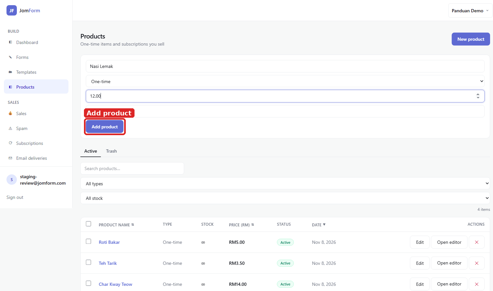
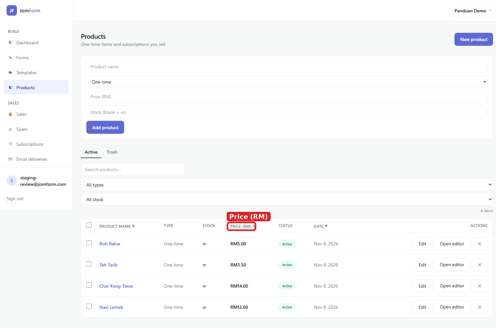
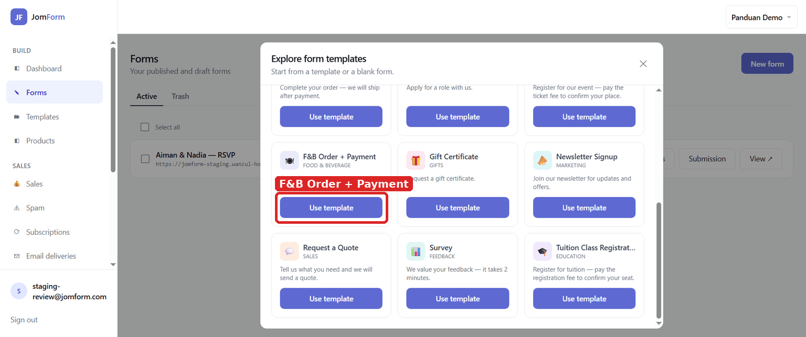
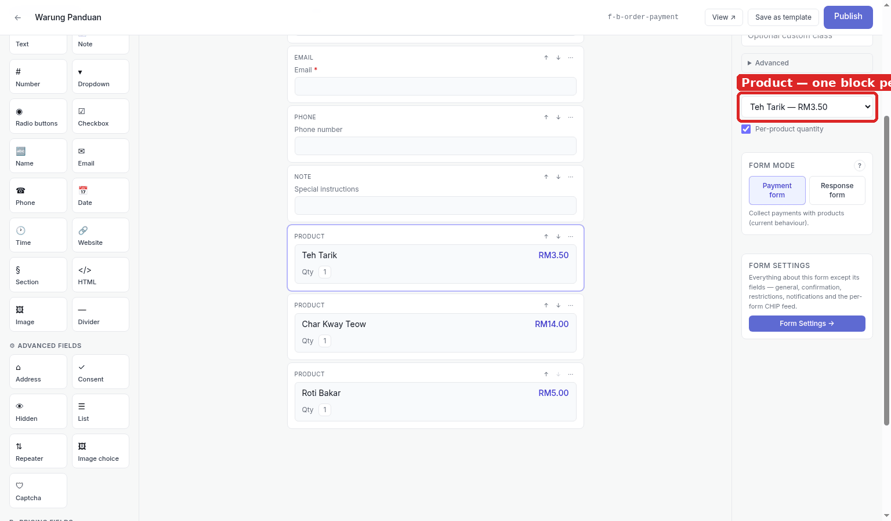
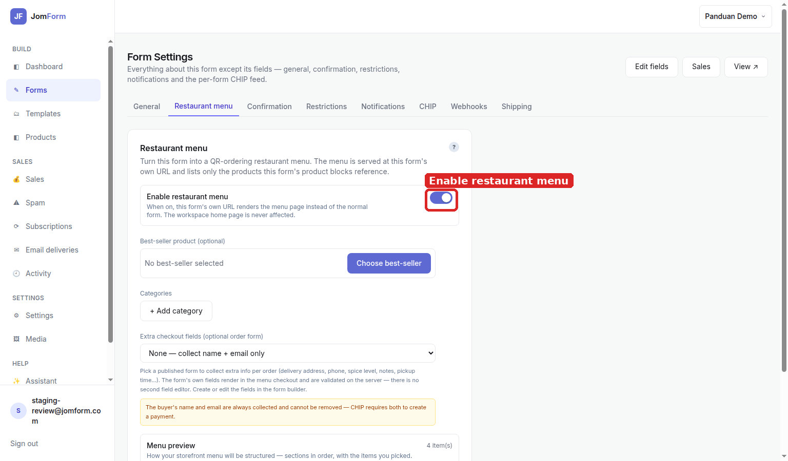
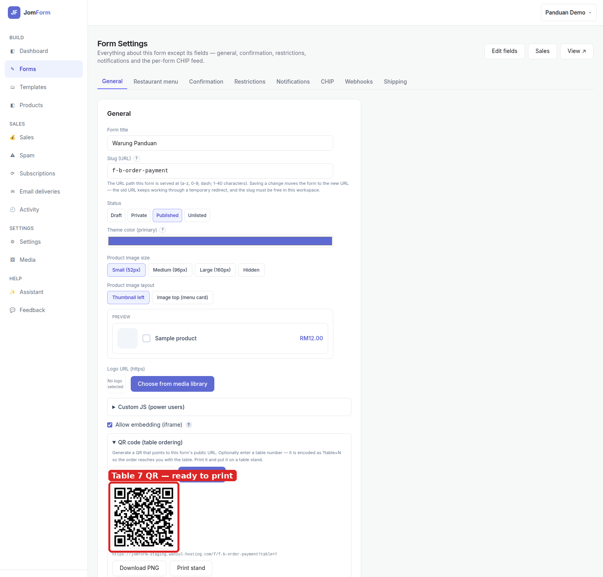
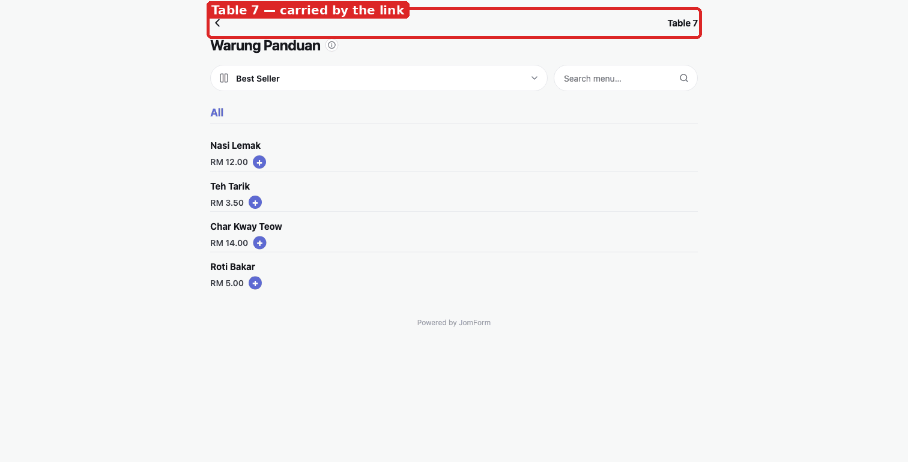

# Table ordering with a QR menu: setup guide

Put a menu behind a QR code on every table, so each order arrives with its table number attached.

**What this does:** each dish is a *product* and a form holds one **Product** block per dish; the
*Restaurant menu* switch serves that form's URL as a menu page, and the QR code is that URL with
`?table=N` on the end.

## 1. Add every dish as a product

Products → fill **Product name** and **Price (RM)** → **Add product**, one product per dish, with
**Stock** left blank for ∞.

## 2. Check the catalogue

The **PRICE (RM)** column is exactly what the diner pays, so fix prices here rather than in the
form.

## 3. Start from the F&B template

Forms → **New form** → **F&B Order + Payment** → **Use template**, which arrives as a payment form
with a Section intro, one Product block, then Name, Email, Phone and Special instructions.

## 4. One Product block per dish

Click **Product** under *PRICING FIELDS* once per dish, and bind each block to its dish in
**BLOCK SETTINGS → Product**.

## 5. Turn the form into a menu

**Form Settings → Restaurant menu → Enable restaurant menu** serves the menu at this form's own URL
and never touches the workspace home page.

## 6. Generate the table QR

**Form Settings → General → QR code (table ordering)**: type the table number and press
**Generate QR**. The code encodes `…/f/f-b-order-payment?table=7`, so nothing but the number changes
between tables.

## 7. What the diner scans into

The diner gets a **Best Seller** filter, a search box, the categories and a row per dish, plus a
**Table 7** banner that came from the QR link. In the basket they also pick a payment method, and the
**Bayar** button names the pick.

## Notes

- **The form has to be published.** The menu is the published form's public page; a draft shows the
  normal form instead.
- **Changing a price is a Products change.** The menu reads the live product, so no republish is
  needed for a price.
- **A dish with no Product block never appears.** The menu is built from the blocks, not from the
  catalogue.
