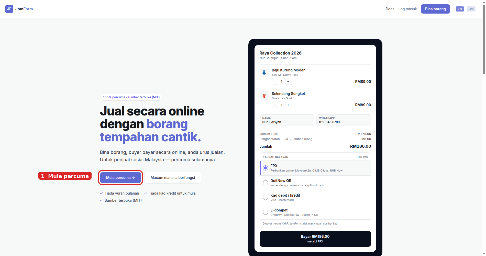
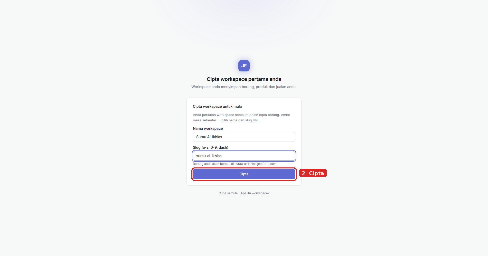
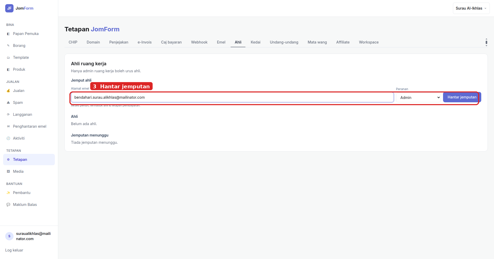
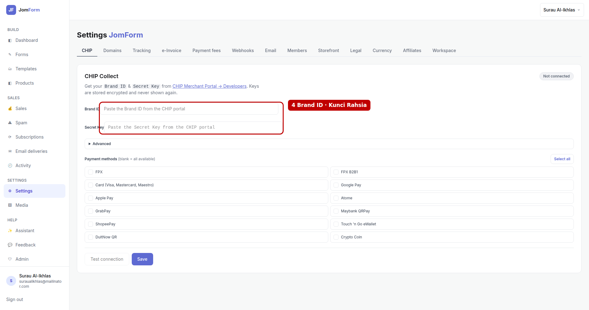
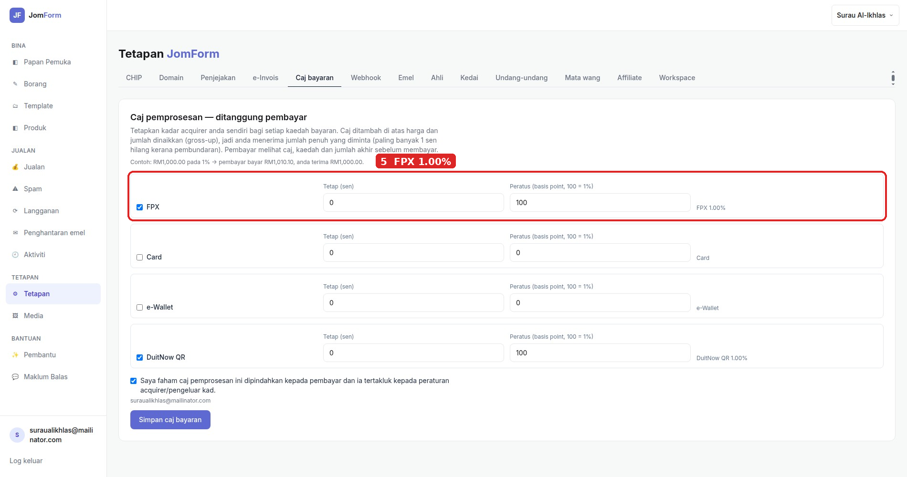
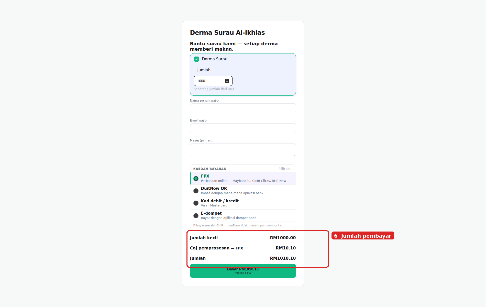
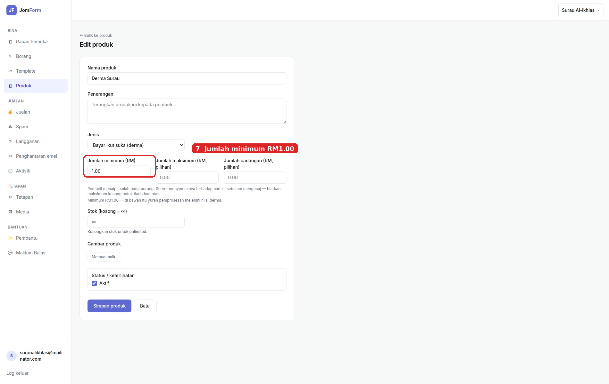
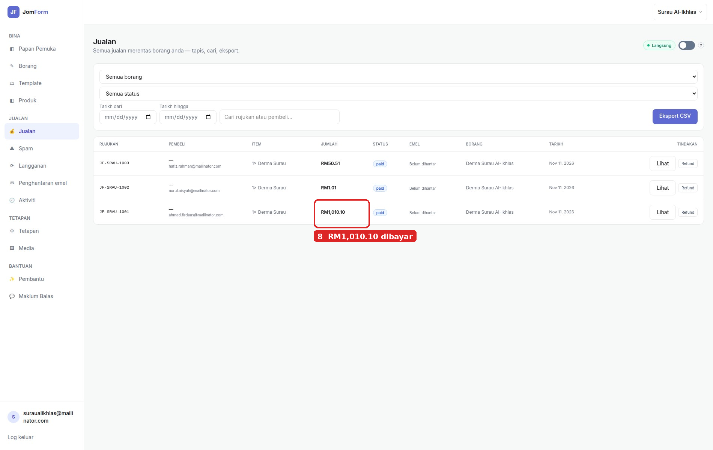
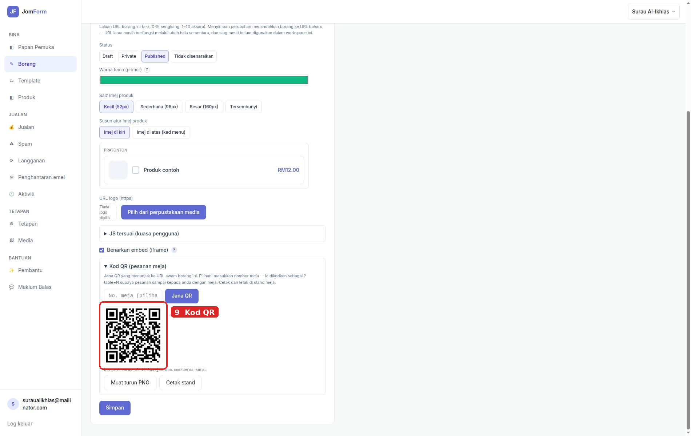

# Panduan derma surau: kutip derma dengan JomForm dan CHIP

Sembilan langkah untuk jawatankuasa surau mengutip derma dalam talian dengan JomForm, dengan caj CHIP ditanggung pembayar — bukan oleh surau.

## 1. Daftar akaun surau

Buka **jomform.com**, klik **Mula percuma →**, dan taip **e-mel kongsi jawatankuasa** — bukan e-mel peribadi seorang ahli. JomForm menghantar **pautan ajaib**; klik pautan itu dalam peti masuk kongsi untuk sahkan akaun. Tiada kata laluan untuk diingat atau dikongsi.

## 2. Cipta workspace surau

Isi **Nama workspace** dengan nama penuh surau dan pilih slug URL, kemudian klik **Cipta**. Nama inilah yang pembayar nampak pada halaman bayaran.

## 3. Jemput ahli jawatankuasa

Settings → **Ahli** → taip e-mel bendahari atau imam, pilih **Peranan**, kemudian **Hantar jemputan**. Setiap ahli masuk dengan akaun sendiri, jadi tiada satu log masuk dikongsi.

## 4. Sambungkan akaun pedagang CHIP

Dalam Portal Pedagang CHIP → **Developers**, salin **Brand ID** dan **Secret Key**. Di JomForm: Settings → **CHIP**, tampal kedua-duanya, kemudian **Simpan**. JomForm mengesahkan pasangan itu dengan CHIP, menyimpannya **disulitkan**, dan hanya memaparkan hujung kunci ("berakhir 4f2a"). Tiada pilihan Mod: kunci itu sendiri menentukan sama ada bayaran itu ujian atau sebenar.

## 5. Tetapkan caj CHIP pada pembayar

Settings → **Caj bayaran**. Salin **dua nombor** daripada kontrak CHIP anda: **Tetap (sen)**, caj tetap setiap transaksi, dan **Peratus (basis point, 100 = 1%)**. Tandakan kaedah yang surau terima — **FPX** dan/atau **DuitNow QR** — tandakan **pengakuan**, kemudian **Simpan caj bayaran**.

Dengan caj diaktifkan, **pembayar** membayar caj itu dan surau menerima derma penuh. Dengan caj dimatikan, surau yang menanggungnya: derma RM1,000.00 pada 1% bermakna surau menerima RM990.00.

## 6. Kenapa pembayar bayar lebih daripada yang dia taip

Derma **RM1,000.00** pada **1%**:

| Baris | Jumlah |
|---|---|
| Jumlah kecil (derma) | RM1,000.00 |
| Caj pemprosesan — FPX 1.00% | RM10.10 |
| **Jumlah dibayar pembayar** | **RM1,010.10** |

Surau menerima tepat **RM1,000.00**. Sebabnya: CHIP mengira peratusannya pada jumlah yang pembayar **benar-benar bayar**, bukan pada derma yang diminta. Kalau anda hanya menambah 1% pada RM1,000.00 (RM1,010.00), CHIP tetap mengambil RM10.10 dan surau tinggal **RM999.90 — kurang 10 sen**. Jadi JomForm mencari jumlah terkecil yang menutup caj: RM1,010.10.

## 7. Bina borang derma

Forms → **Borang baru** → mod **Borang bayaran**, kemudian tambah produk jenis **Bayar ikut suka (derma)** dengan **Jumlah minimum** RM1.00 — had terendah yang dibenarkan sistem, supaya caj tetap sentiasa dapat ditutup. **Terbitkan** borang, kemudian salin pautan awamnya.

## 8. Uji sendiri dengan RM1.00

Buat satu derma sebenar RM1.00 dan selesaikan bayaran. Dalam **Jualan**, baris itu menunjukkan jumlah yang pembayar bayar: derma RM1,000.00 muncul sebagai **RM1,010.10**. Baris caj itu sendiri ada pada resit pembeli — **Caj pemprosesan — FPX 1.00%: RM 10.10** — jadi derma surau ialah jumlah bayar tolak caj.

## 9. Edarkan pautan dan kod QR

Kongsi pautan borang dalam kumpulan WhatsApp surau, atau jana **Kod QR** di Form Settings → **Kod QR (pesanan meja)**, kemudian klik **Muat turun PNG** atau **Cetak stand** untuk papan notis. Jumlah derma harian: **Jualan** → tapis **Tarikh dari** dan **Tarikh hingga**.

## Nota

- Kadar dicatat pada setiap jualan, jadi menukar kadar kemudian tidak mengubah jualan atau resit yang lalu.
- SST tidak ditambah di atas kadar ini. Kalau acquirer anda menyebut kadar termasuk SST, masukkan angka itu.
- Halaman bayaran dan resit memaparkan jumlah tanpa pemisah ribu (RM1010.10); senarai Jualan menulis RM1,010.10. Nombornya sama.
- Penerimaan kad ialah risiko pedagang; pengakuan di langkah 5 direkodkan bersama e-mel dan masanya.
