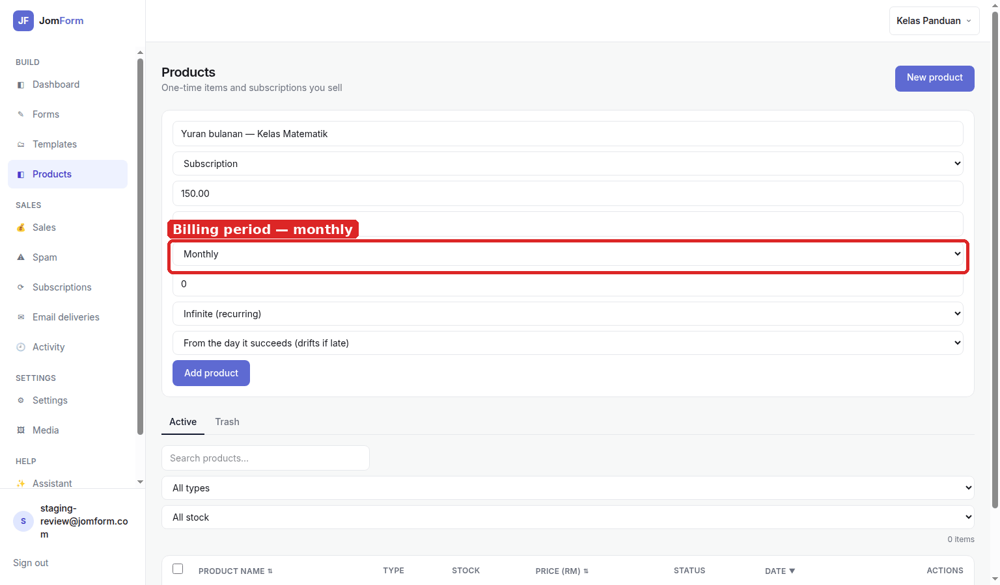
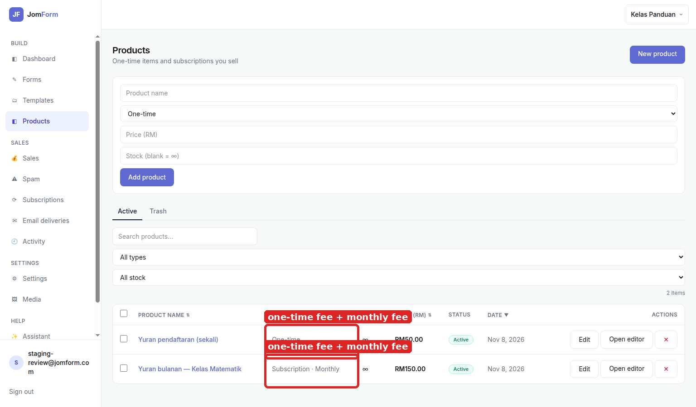
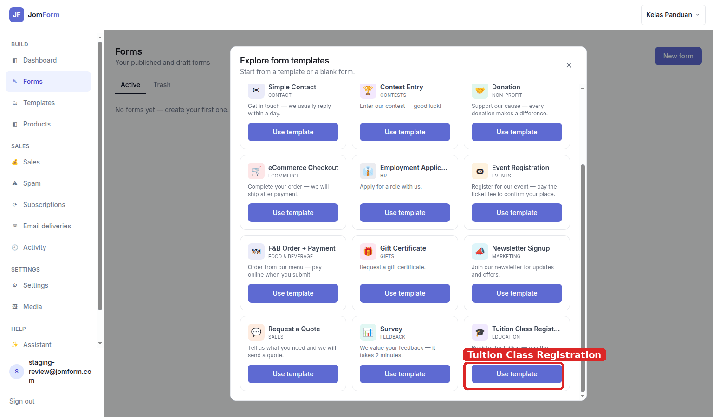
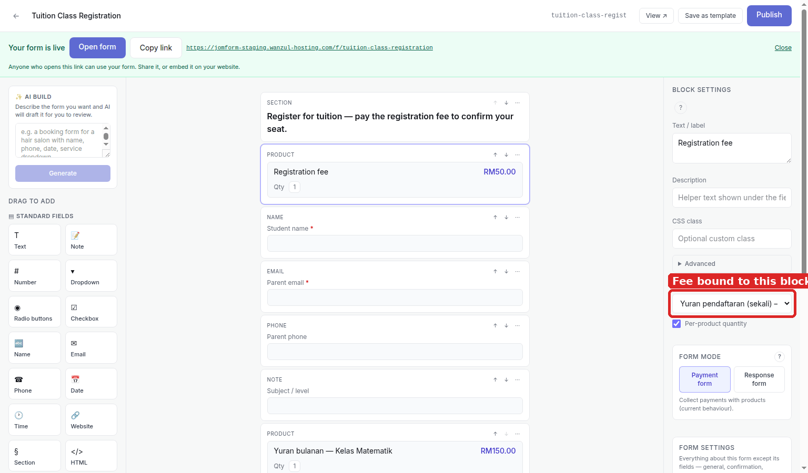
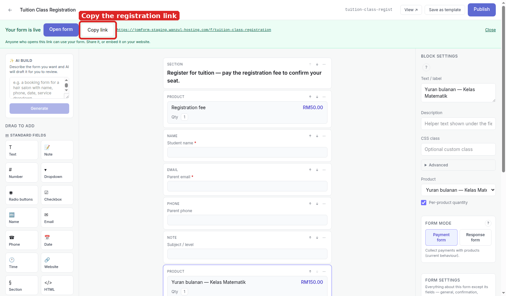
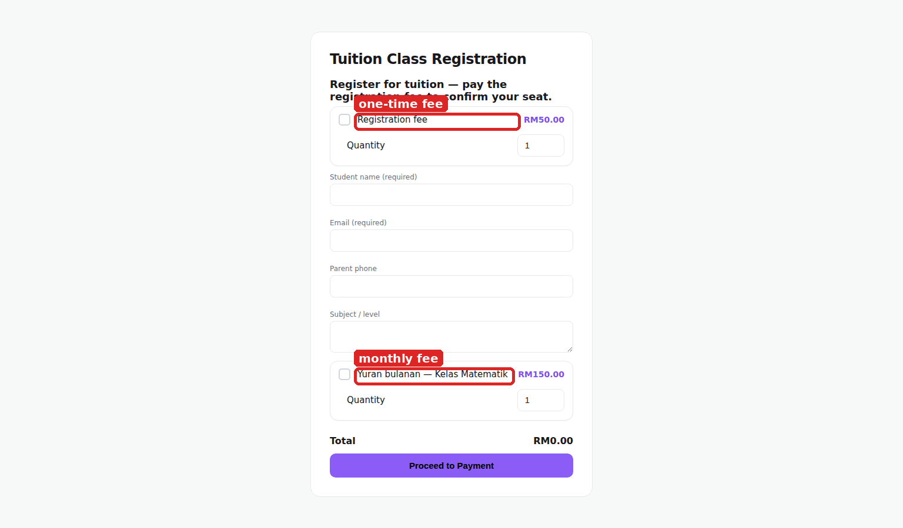

# Tuition / class registration — setup guide

A registration form that takes a one-time fee today and a monthly class fee after that. Every
screenshot here was captured from the running product; the red box marks the control you touch at
that step.

**What this does:** a tuition class needs two different amounts — a registration fee paid once, and
a monthly fee that repeats. JomForm products carry both shapes: **One-time** and **Subscription**.
The form holds one **Product** block per fee, so the parent sees both lines on the same page and one
checkout covers them.

## 1. Make the monthly fee a Subscription product

Products → **Product name** + **Price (RM)**, then switch **Type** from *One-time* to **Subscription**.
The row expands into the recurring controls: **Billing period** (*Monthly* here), **Trial days**,
**Billing count** (*Infinite (recurring)* or *Fixed N times*), and **Next charge date** (*From the day
it succeeds (drifts if late)*, or keep the original dates and collect/skip missed months).

## 2. Add the one-time registration fee

Add the registration fee with **Type** left on *One-time*. The list now shows the two shapes side by
side — **One-time** RM50.00 and **Subscription · Monthly** RM150.00 — and that difference is the whole
tuition story: one charge to confirm the seat, one charge that repeats every month.

## 3. Start from the Tuition Class Registration template

Forms → **New form** → **Tuition Class Registration** → **Use template**. The template arrives as a
payment form with a Section intro (*pay the registration fee to confirm your seat*), one Product
block, **Student name**, **Parent email**, **Parent phone** and **Subject / level**.

## 4. Bind both fees to the form

Select the Product block, then **BLOCK SETTINGS → Product** picks the fee it sells — here
*Yuran pendaftaran (sekali)*. Press **Product** once more under *PRICING FIELDS* and bind the second
block to *Yuran bulanan — Kelas Matematik*. **Text / label** is what the parent reads, so name the
blocks after the fee, not after the template.

## 5. Publish and copy the link

**Publish** puts the form live and the green banner hands you the address
(`…/f/tuition-class-registration`). **Copy link** is what goes into the class WhatsApp group or the
school's page.

## 6. What the parent sees

The parent gets the intro line, the **Registration fee RM50.00** line, the student's details, the
**Yuran bulanan — Kelas Matematik RM150.00** line, a **Total** and one **Proceed to Payment**
button. Each fee is its own checkbox with a **Quantity**, so a family enrolling two children ticks 2
on the registration fee without touching the monthly one.

## Notes

- **A subscription product is still just a product.** The same block can sell it from any form in the
  workspace; the recurring behaviour comes from the product row, not from the form.
- **Billing count decides whether it ever stops.** *Infinite (recurring)* charges until cancelled;
  *Fixed N times* stops after N charges — useful for a 10-month programme.
- **The total is zero until a fee is ticked.** Both fee blocks start unchecked, which is why the
  page shows **Total RM0.00** on load — tick a fee and the amount and the payment step follow.
