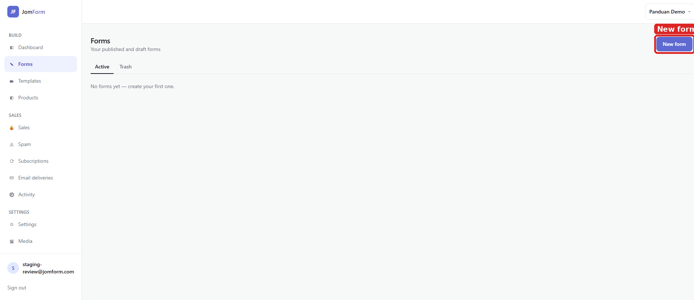
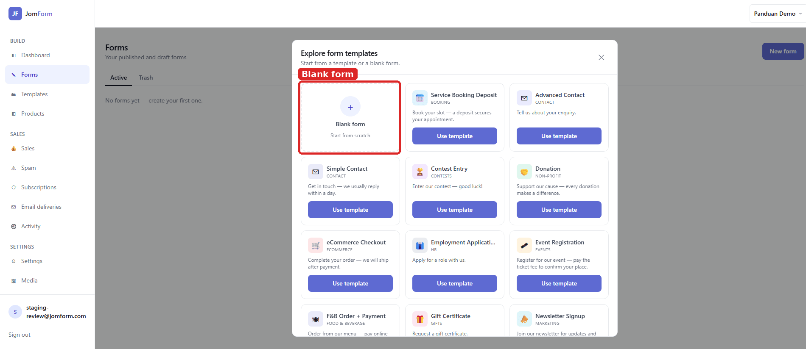
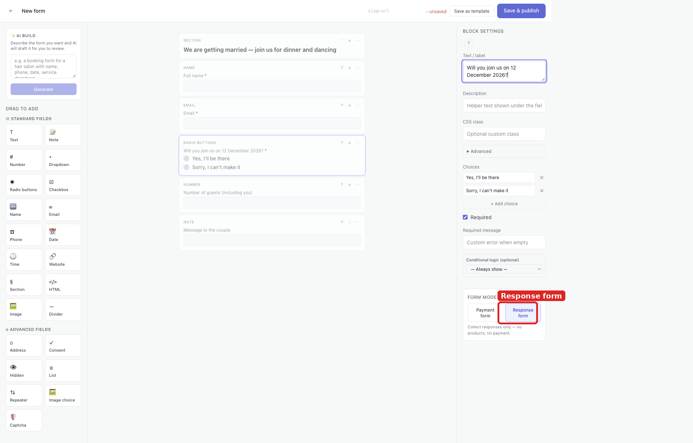
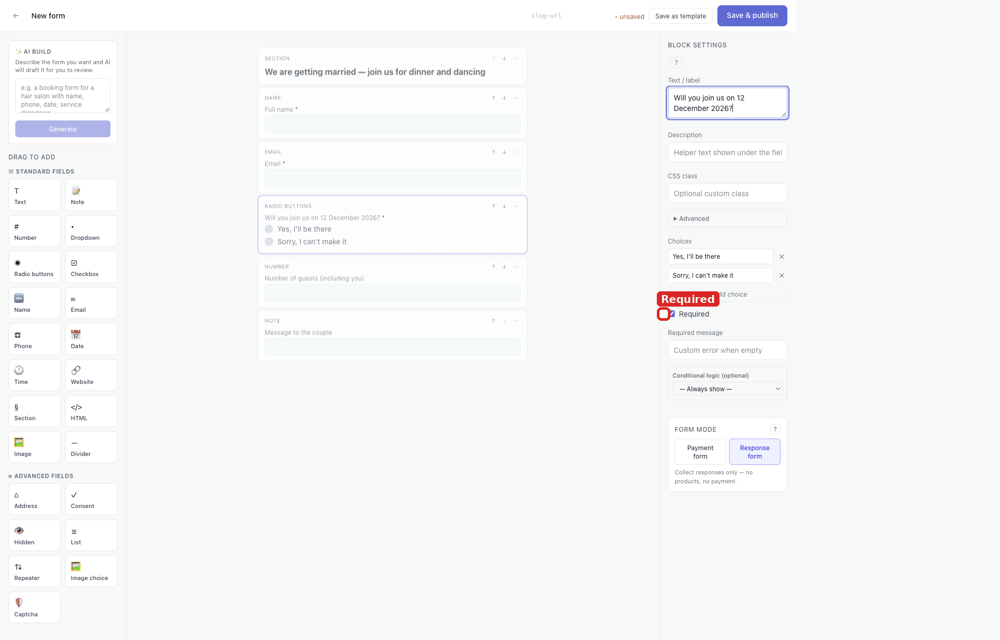
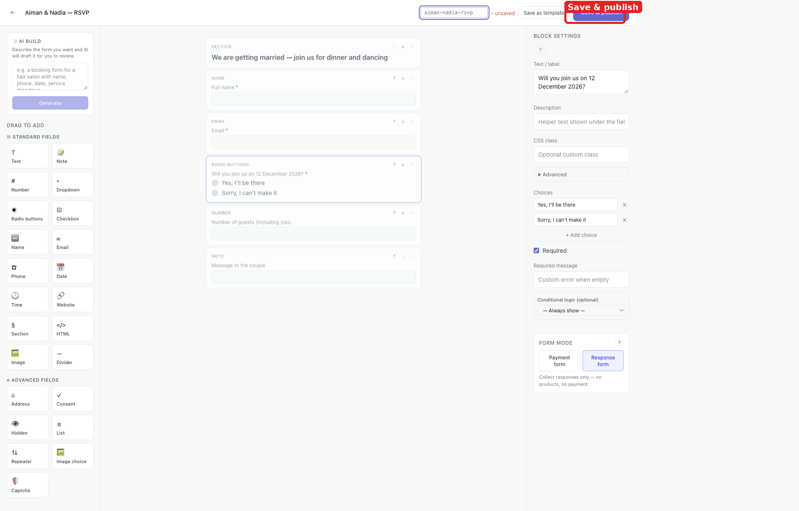
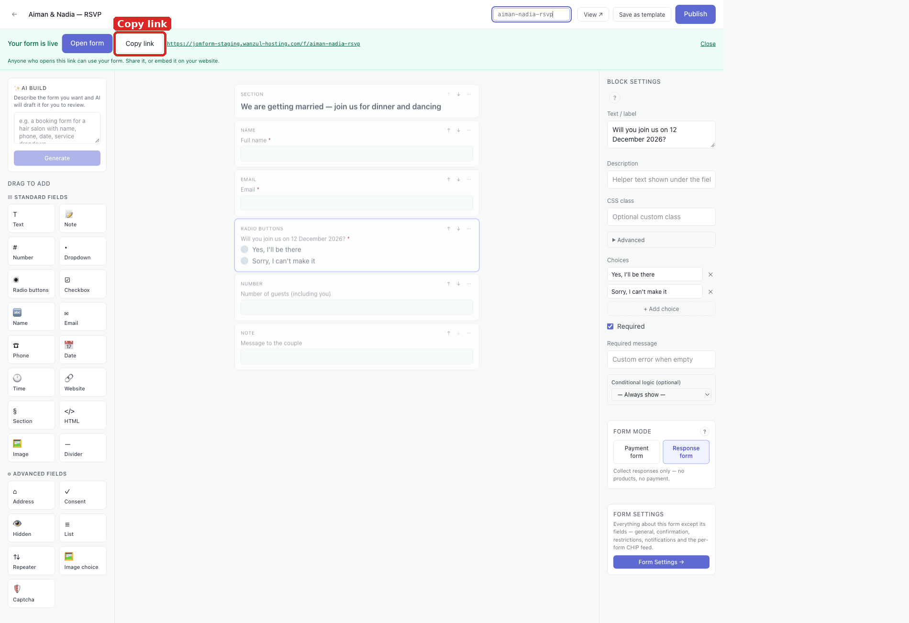
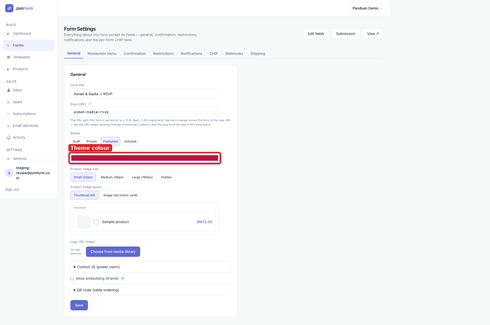
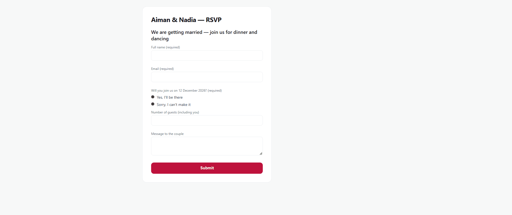
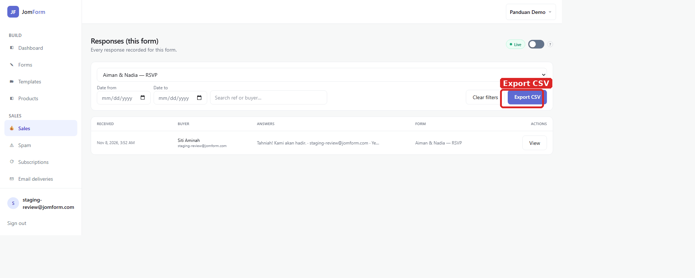

# Wedding page + RSVP form — setup guide

A step-by-step guide to putting a wedding page and an RSVP form online with JomForm. Every
screenshot below was captured from the running product; the red box marks the control you touch at
that step.

**What this does:** an RSVP collects answers, not money, so the form runs in *response* mode: the
couple gets a page with a title, a short invitation line and the questions they need answered —
who is coming, how many guests, and a message. The form has its own public link, so it can go
straight into a WhatsApp invitation, and it can sit behind a full landing page (see the Notes).

## 1. Start a new form

Forms → **New form**. Every form in JomForm starts here; the list on this page holds the drafts and
the published forms of the workspace you are in (its name is at the top right — *Panduan Demo*
here).

## 2. Choose Blank form

**New form** opens the template gallery. There is no wedding template in it, so start from
**Blank form** — the gallery's other cards (Event Registration, Donation, F&B Order + Payment,
Tuition Class Registration, …) are for the other showcases. A blank form gives you an empty canvas
and the full field palette.

## 3. Set Form mode to Response form

In the builder, the right-hand panel has **FORM MODE** at the bottom. Pick **Response form** —
*Collect responses only — no products, no payment.* Leave it on *Payment form* and the form will
expect a product to sell; an RSVP has nothing to sell.

## 4. Add the questions and mark the required ones

Click a field in the **palette** on the left to add it to the form. For an RSVP:

| Block | Label used here | Notes |
|---|---|---|
| **Section** | We are getting married — join us for dinner and dancing | A heading, not a question |
| **Name** | Full name | Required by default |
| **Email** | Email | Required by default |
| **Radio buttons** | Will you join us on 12 December 2026? | Edit the two choices in *Choices* |
| **Number** | Number of guests (including you) | Optional — only an attending guest answers it |
| **Note** | Message to the couple | Free-form message |

Select a block and its settings appear in the right-hand panel: **Text / label**, Description,
Placeholder, an **Advanced** disclosure, and **Required**. Tick **Required** on the question that
must be answered — here the attendance radio — so the guest cannot submit without it. (A *Text*
block that reads like a sentence offers **Treat as intro line** and becomes a heading; use
**Section** for that from the start.)

## 5. Publish

**Save & publish** in the top bar writes the form and puts it live in one step. Until you click it
the toolbar shows **• unsaved** and the form stays a draft that nobody else can open.

## 6. Copy the public link

The green **Your form is live** banner confirms the publish and holds the guest URL —
**Copy link** (or **Open form**) is what you paste into the invitation, a poster QR code, or your
website.

## 7. Set the theme colour

The form's look lives in **Form Settings**, not in the builder: open it from the form's row in
Forms (or the **Form Settings →** button at the bottom of the builder's right panel). Under
**General**, **Theme color (primary)** is the colour of the page's buttons and accents — the
PREVIEW panel next to it shows a sample product in that colour. The same tab carries **Status**
(*Draft / Private / Published / Unlisted*), **Logo URL (https)**, **Custom JS** and
**Allow embedding (iframe)**; press **Save** at the bottom and the page answers **Saved ✓**.

## 8. What the guest sees

Anyone with the link gets the title, the invitation line, the five fields and one **Submit** button
in the theme colour you chose. The labels marked required carry *(required)*, and the guest never
sees the dashboard.

## 9. Read the replies

There is no separate inbox: **Submission** at the top of Form Settings opens **Sales** filtered to
this form — *Responses (this form)* — and each RSVP is one row with its **Received** time, the
**Buyer**'s name and email, the answers, and a **View** action that opens the full reply.
**Export CSV** downloads every reply in the filter.

## Notes

- **A full page in front of the form is optional.** Settings → **Storefront** turns the workspace's
  home page into a landing page (hero, subtitle, body, image, logo and a CTA button that points at
  the form), for when you want the couple's story and photos on a page of their own rather than
  just the form. The [design-with-MCP guide](../design-with-mcp/README.md) walks that page.
- **The slug can change without breaking invitations.** Saving a new slug moves the form to the new
  URL and the old address keeps working through a temporary redirect, so a link already sent still
  lands on the form.
